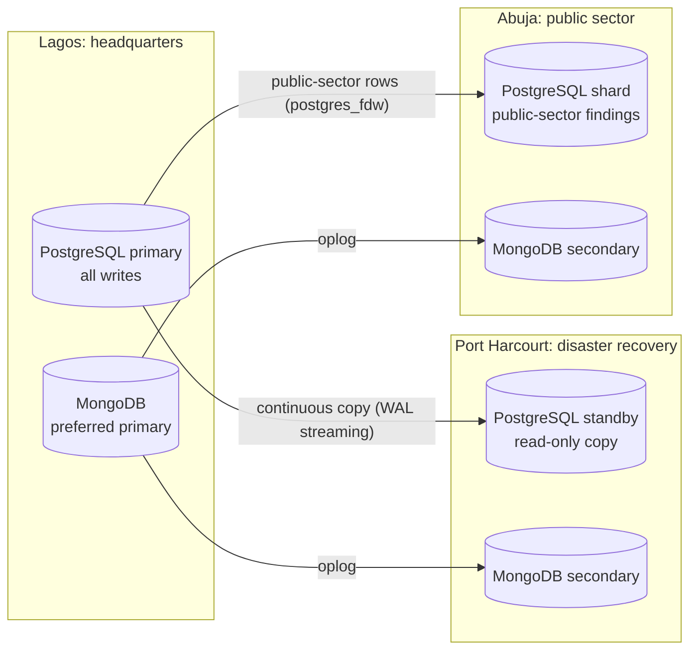

# Advanced Database Systems Portfolio: TerraCyber Consulting

**Course:** MIT 8103 Advanced Database Systems, MIVA Open University, 2026/2027 First Semester
**Student:** Osita Kingsley Odo

## 1. The project Summary

This project designs, builds and tests a database for **TerraCyber Consulting**, a Nigerian cybersecurity consultancy. The database is called the **Engagement and Assurance Database (EAD)**. It records the consultancy's clients, the security assessments it carries out for them, the vulnerabilities it finds, the compliance controls it checks, the training it delivers and the money it bills.

The assessment brief asks for five practical portfolios, all built on the same organisation. Each portfolio tests a different area of advanced database work. Together they show one realistic system, from design through to running across three cities.


**Key idea:** one organisation runs through all five portfolios. A design decision in Portfolio 1 (for example, the `state` table) is reused in Portfolio 2 (query Q8) and Portfolio 5 (which office serves which client). This makes the project one connected system rather than five separate exercises.

## 2. Case study statement

| Item | Description |
| --- | --- |
| **Organisation** | TerraCyber Consulting ([terracybconsulting.com](https://terracybconsulting.com)), a Nigerian cybersecurity consultancy delivering grounded, human-centred cybersecurity |
| **Locations** | Three sites: **Lagos** (headquarters, primary database), **Abuja** (northern office, public-sector data shard) and **Port Harcourt** (South South and South East office, disaster-recovery standby). See [section 3](#3-where-terracyber-operates-and-why). |
| **Nature of the business** | Consultancy for NGOs, public sector bodies and private firms in all six geopolitical zones of Nigeria |
| **Database** | Engagement and Assurance Database (EAD) |
| **Major data** | Offices, the 36 states and FCT with their serving office, consultants, clients and their sites, engagements and staffing, client assets, vulnerability findings, compliance frameworks and controls, control assessments, audit evidence, training sessions and attendance, invoices and payments, audit trail |
| **Key operations** | Open and staff an engagement; log and triage findings; assess controls against ISO/IEC 27001, the Nigeria Data Protection Act 2023 (NDPA) or NIST CSF 2.0; attach evidence; track remediation; deliver training and record results; invoice in naira and record payments; produce client compliance reports |

### 2.1 What the business does

| Service line | Typical work |
| --- | --- |
| Compliance and data protection | Assess clients against ISO/IEC 27001, the NDPA 2023 and NIST CSF 2.0; collect evidence; report gaps |
| Advisory and resilience | Vulnerability assessments, scanning client assets, tracking remediation |
| Training and security awareness | Phishing awareness, password and multi-factor authentication hygiene, safe handling of beneficiary data |

### 2.2 Who uses the database

- **Consultants and analysts** log findings and assess controls.
- **Engagement managers** plan engagements, allocate staff hours and track budgets.
- **Trainers** record training sessions, attendance and quiz scores.
- **Finance staff** issue invoices in naira and record payments.
- **Auditors** have read-only access to the audit trail.
- **Client contacts** see their own results through a read-only portal.

### 2.3 Why this organisation was chosen

The brief asks for an organisation "with enough data and processes" for all five portfolios. 

| Portfolio need | Where TerraCyber provides it |
| --- | --- |
| Many related entities (Portfolio 1) | Clients, sites, assets, engagements, findings, controls, invoices |
| Enough data to optimise (Portfolio 2) | Vulnerability scans produce tens of thousands of findings |
| Money and status changes (Portfolio 3) | Payments, closing findings, allocating consultant hours |
| Data of varying shape (Portfolio 4) | Audit evidence: scan reports, policies, firewall configurations, interview notes |
| Network relationships (Portfolio 4) | Which client machine can reach which: attack paths |
| Multiple sites (Portfolio 5) | Offices and data centres in Lagos, Abuja and Port Harcourt |

It is also a field the student works in, which makes every design choice explainable in a verification call.

**About the data:** all clients, people, hostnames and IP addresses are fictitious. Real client data would breach confidentiality and the NDPA. The vulnerability identifiers (for example CVE-2021-44228, known as Log4Shell) are real public CVEs, used to make the findings realistic.

## 3. Where TerraCyber operates, and why

TerraCyber works from three Nigerian cities. They were not picked by assumption: each candidate city was scored against evidence. The full analysis, with sources, is in [docs/site-selection.md](docs/site-selection.md).

| Site | Office role | Database role | Main reason |
| --- | --- | --- | --- |
| **Lagos** | Headquarters | Primary: all writes go here | 21 of Nigeria's 28 data centres, most subsea internet cables, largest client market |
| **Abuja** | Northern office | Public-sector shard: stores public-sector clients' findings | Federal government, the regulators (NDPC, NITDA, CBN) and a Tier III government data centre |
| **Port Harcourt** | South South and South East office | Disaster-recovery standby: a live copy of Lagos | The only international internet route that does not pass through Lagos (the 2Africa cable) |

Lagos was fixed as the primary first, because it leads on every infrastructure measure. The remaining candidates were scored 1 to 5 on seven weighted factors, converted to a total out of 100:

| City | Data centres (20) | Own internet route (15) | Clients (20) | Regulators (10) | Security (15) | Distance from Lagos (10) | Flood (10) | Total |
| --- | ---: | ---: | ---: | ---: | ---: | ---: | ---: | ---: |
| **Abuja** | 4 | 3 | 5 | 5 | 3 | 5 | 3 | **80** |
| **Port Harcourt** | 3 | 5 | 4 | 1 | 3 | 4 | 3 | **68** |
| Kano | 3 | 2 | 3 | 1 | 3 | 5 | 3 | 57 |
| Enugu | 2 | 2 | 3 | 1 | 5 | 4 | 3 | 57 |
| Ibadan | 1 | 2 | 3 | 1 | 5 | 1 | 3 | 47 |

- **Kano** is the strongest alternative: it has Nigeria's only Tier IV data centre, but scores lower on internet routes and client demand.
- **Ibadan** is only 114 km from Lagos, so one regional disaster could affect both. That rules it out as a backup site.
- **Flood risk does not separate the cities:** every candidate state, and Lagos, is on the 2026 national high-flood-risk list. It is handled by choosing certified data centres inside each city.
- **The result is robust:** removing the security factor entirely still ranks Abuja first and Port Harcourt second.

**Why the data is split by sector, not by region.** All three sites are inside Nigeria. The NDPA regulates transfers of personal data **outside** Nigeria (sections 41 to 43), so it does not force data into one region or another. The rules that do care where data is hosted are **sector** rules: NITDA's cloud policy for government data, and the Central Bank of Nigeria's requirement that payment data be hosted locally from 1 January 2027.



## 4. How the repository is organised

```
MIVA-Data-Base-Management-for-Terracyb-Consulting/
├── portfolio-1-database-design/          schema, seed data, constraint tests, ER diagram, screenshots
├── portfolio-2-query-optimisation/       9 queries, indexes, benchmark, plans, results, screenshots
├── portfolio-3-transactions-concurrency/ 5 scenarios, two-terminal lock demo, logs, screenshots
├── portfolio-4-nosql/                    MongoDB and Neo4j scripts, Docker setup
├── portfolio-5-distributed-cloud/        7-node Docker setup, sharding and failover, logs, screenshots
├── docs/                                 explainer (Word), design decisions, site selection, LMS template
└── README.md                             this file
```

| Folder or file | Contents |
| --- | --- |
| [docs/TerraCyber_Database_Project_Explainer.docx](docs/TerraCyber_Database_Project_Explainer.docx) | Plain-language explainer of the whole project (Word) |
| [docs/design-decisions.md](docs/design-decisions.md) | Register of 71 decisions (D01 to D71), each with alternatives considered and the reason |
| [docs/site-selection.md](docs/site-selection.md) | Evidence and scoring behind Lagos, Abuja and Port Harcourt |
| [docs/lms-documentation-template.md](docs/lms-documentation-template.md) | Template for the 2-3 page LMS document |

Every portfolio README follows the same pattern: what the portfolio delivers, its key decisions and reasons, the concepts in plain terms, how to run it, the results with screenshots, and an evidence checklist.

## 5. Evidence at a glance

The screenshots and output files below were captured from **test runs on 14 November 2026** (PostgreSQL 16.15). Each screenshot shows the exact command that was run and its unedited output; the caption under each one says how it was captured. See [section 9](#9-what-is-left-to-do) and [section 13](#13-ai-use-declaration) for how to treat them.

| Portfolio | Screenshots | Output files |
| --- | --- | --- |
| 1 | [ER diagram](portfolio-1-database-design/erd.png), [18 tables](portfolio-1-database-design/screenshots/01-tables.png), [seed row counts](portfolio-1-database-design/screenshots/02-seed-row-counts.png), [12 constraint tests](portfolio-1-database-design/screenshots/03-constraint-tests.png) | `constraint-test-output.txt`, `output/seed-row-counts.txt` |
| 2 | [Q1 plan before and after](portfolio-2-query-optimisation/screenshots/01-q1-plan-before-after.png), [benchmark](portfolio-2-query-optimisation/screenshots/02-benchmark.png), [Q8 result](portfolio-2-query-optimisation/screenshots/03-q8-result.png) | `results/timings.md`, `results/query-results/`, `plans/` |
| 3 | [two-terminal lock wait](portfolio-3-transactions-concurrency/screenshots/01-lock-wait-two-terminals.png), [lock monitor](portfolio-3-transactions-concurrency/screenshots/02-lock-wait-monitor.png), [lost update](portfolio-3-transactions-concurrency/screenshots/03-lost-update-script.png), [isolation](portfolio-3-transactions-concurrency/screenshots/04-isolation-non-repeatable-read.png), [SERIALIZABLE](portfolio-3-transactions-concurrency/screenshots/05-serializable-write-skew.png), [deadlock](portfolio-3-transactions-concurrency/screenshots/06-deadlock.png) | `output/01` to `output/05` logs |
| 4 | Not yet: needs Docker on your machine (MongoDB and Neo4j) | |
| 5 | [replication](portfolio-5-distributed-cloud/screenshots/01-replication-status-and-read-only.png), [sharding](portfolio-5-distributed-cloud/screenshots/02-geo-sharding.png), [failover](portfolio-5-distributed-cloud/screenshots/03-failover-promotion.png) (three local PostgreSQL servers, not Docker) | `output/local-test-*.log` |

## 6. Design decisions

Every significant choice, from the three sites to individual column types and index choices, is recorded with the alternatives considered and the reason. The full register is [docs/design-decisions.md](docs/design-decisions.md). These are the decisions most likely to come up in a verification call:

| ID | Decision | Reason |
| --- | --- | --- |
| D01 | TerraCyber as the case study | Supplies every ingredient the five portfolios need, in a field the student works in |
| D02 | Lagos, Abuja and Port Harcourt | Highest evidence-based scores; each site has a distinct, justified role |
| D06 | PostgreSQL 16 | One free DBMS covers Portfolios 1, 2, 3 and 5: partial indexes, true SERIALIZABLE, partitioning, replication |
| D13 | TEXT with CHECK instead of ENUM | Allowed values are easy to change and visible next to the column |
| D14 | NUMERIC for money | Exact decimals; floating point cannot store amounts exactly |
| D16 | Separate `state` table | Zone depends on the state, not the client: required for 3NF |
| D17 | Severity as a generated column | It is fully determined by the score, so it must not be stored separately |
| D19 | Protect findings and billing from cascading deletes | Evidence and financial records must never vanish by accident |
| D37 | No index for some queries | Shows when an index does not help; every index slows writes |
| D46 | Row lock for the lost update | Protects the read, decide, then write pattern a manager follows |
| D47 | SERIALIZABLE for write skew | The managers change different rows, so normal locks never conflict |
| D51 | Embed scan results, reference clients | Read together versus changing elsewhere |
| D61 | Shard by sector | The rules about where data sits are sector rules, not regional ones |
| D67 | One MongoDB member per city | Any one city can fail and a majority remains |

## 7. Technology stack

| Tool | Version | Used in |
| --- | --- | --- |
| PostgreSQL | 16 | Portfolios 1, 2, 3, 5 |
| MongoDB | 7.0 | Portfolios 4, 5 |
| Neo4j Community | 5 | Portfolio 4 |
| Docker and Docker Compose | current | Portfolios 4, 5 |
| Graphviz | current | ER diagram image (`erd.png`) |
| psql, mongosh, cypher-shell | bundled | All scripts |

## 8. How to run the project

**What you need:** PostgreSQL 16 with `psql` (Portfolios 1 to 3); Docker Desktop (Portfolios 4 and 5); on Windows, WSL or Git Bash to run the `.sh` scripts.

```bash
# Portfolios 1 to 3: local PostgreSQL 16
createdb ead
psql -d ead -f portfolio-1-database-design/schema.sql
psql -d ead -f portfolio-1-database-design/seed.sql
psql -d ead -f portfolio-1-database-design/test_constraints.sql

cd portfolio-2-query-optimisation && ./run_queries.sh && ./run_benchmark.sh && cd ..
cd portfolio-3-transactions-concurrency && ./run_all.sh && cd ..

# Portfolios 4 and 5: start the containers, then follow each README
cd portfolio-4-nosql && docker compose up -d && cd ..
cd portfolio-5-distributed-cloud && docker compose up -d && cd ..
```

Each portfolio README gives the full steps, the expected output and an evidence checklist. Stop the Portfolio 4 containers before starting Portfolio 5 if port 5432 is already in use, or change the host port in `portfolio-5-distributed-cloud/docker-compose.yml`.

**Testing status:** every PostgreSQL script was run and checked, and the Portfolio 5 replication, sharding and failover steps were run on three local PostgreSQL servers. The MongoDB, Neo4j and Docker files were checked for syntax only, because Docker images could not be downloaded in the test environment; run them on your own machine.

## 9. What is left to do

1. **Re-run each portfolio on your own machine** and replace the test-run screenshots and outputs with your own captures where you can. Your own runs are the strongest evidence of your work, and they prepare you for questions about the results.
2. **Portfolio 4:** run the MongoDB and Neo4j steps in Docker and add the outputs and screenshots listed in its README.
3. **Portfolio 5:** run the Docker version and add `docker compose ps` and the MongoDB replica set outputs.
4. **Fill in your interpretation** of the Portfolio 2 timings (3 to 5 sentences) in its README.
5. **Complete the AI-use declaration** in [section 13](#13-ai-use-declaration) honestly, in your own words.
6. **Write the LMS document** using [docs/lms-documentation-template.md](docs/lms-documentation-template.md), including your personal reflection.
7. **Make the repository private** and add the assessor as a collaborator before submission.

## 10. Preparing for a verification call

The brief says students may be asked to explain their work. These are likely questions, with short answers drawn from the project.

**Why did you put the geopolitical zone in a separate table?**
Because the zone depends on the state, not on the client. Storing it in the client table would be a transitive dependency, which breaks third normal form. With the `state` table, moving a state to another office is a single-row update.

**Why is severity a generated column?**
Severity is fully determined by the CVSS score. If it were an ordinary column, someone could change one without the other. The database calculates it, so it can never disagree with the score, and it can still be indexed.

**Why did you not add an index for Q3?**
The `control_assessment` table has about 2,300 rows and the query reads almost all of them. A sequential scan is already the cheapest plan, so an index would add write cost without improving the query.

**What is the difference between a partial index and a covering index?**
A partial index only contains rows that match a condition, such as open critical findings, so it is small. A covering index includes extra columns, so the query can be answered from the index alone without reading the table.

**Why did the lost update happen, and how does FOR UPDATE fix it?**
Both managers read the same value before either wrote, so the second write was based on a stale value. `FOR UPDATE` locks the row when it is read, so the second manager waits until the first commits and then reads the new value.

**Why could row locks not prevent the write skew?**
The two managers deleted different rows, so their locks never conflicted. Only SERIALIZABLE isolation detects that the combined result breaks the rule, and it cancels one transaction.

**Why did you embed scan results in MongoDB but only reference the client?**
Scan results are always read with their scan and belong to nothing else, so embedding avoids joins. Client details change and are owned by PostgreSQL, so copying them would create stale duplicates.

**Why Port Harcourt for the backup and not Abuja?**
Port Harcourt has the only international internet route that does not pass through Lagos. A cut to the Lagos cables, like the one in March 2024, would not cut off the backup. Abuja is more valuable as the public-sector site.

**Why shard by sector rather than by region?**
All three sites are in Nigeria, and the NDPA only regulates transfers abroad, so there is no legal reason to split by region. The hosting rules that exist are sector rules for government and payment data.

**What happens if Abuja goes down?**
Public-sector findings become unavailable, but private and NGO data in Lagos is unaffected. This is a known single point of failure: in production, Abuja would get its own standby, with Kano as the next candidate site.

## 11. Glossary

| Term | Meaning |
| --- | --- |
| ACID | Atomicity, consistency, isolation, durability: the four guarantees of a transaction |
| CAP theorem | During a network split, a distributed system must choose consistency or availability |
| CTE | Common table expression: a named sub-query written with WITH |
| CVE / CVSS | A public vulnerability identifier / its severity score from 0 to 10 |
| Deadlock | Two transactions each waiting for a lock the other holds |
| Execution plan | The steps the database chooses to answer a query, shown by EXPLAIN |
| Failover / promotion | Making the standby the new primary when the primary fails |
| Foreign data wrapper (FDW) | Lets one PostgreSQL server query tables on another as if they were local |
| GIN index | An index type for searching inside values, used here for full-text search |
| Materialised view | A stored query result that is refreshed on demand |
| NDPA | Nigeria Data Protection Act 2023 |
| Normalisation (1NF to 3NF) | Organising tables so each fact is stored once and depends only on its key |
| Partition / shard | A piece of a table stored separately, possibly on another server |
| Replica / standby | A continuously updated copy of the primary database |
| SERIALIZABLE | The strictest isolation level: results are as if transactions ran one at a time |
| WAL | Write-ahead log: the record of every change, used for crash recovery and replication |
| Write skew | Two transactions each change different rows and together break a rule neither breaks alone |

## 12. Progress log

The brief rewards progressive commits. Record each milestone when it is committed.

| Date | Portfolio | Work committed |
| --- | --- | --- |
| | 1 | Case study statement, ER diagram, schema |
| | 1 | Seed data, constraint tests, normalisation write-up |
| | 2 | Queries and baseline plans |
| | 2 | Indexes, after plans, performance analysis |
| | 3 | Transaction scenarios, logs and screenshots |
| | 4 | MongoDB model, queries and indexes |
| | 4 | Neo4j graph and suitability analysis |
| | 5 | Replication and failover |
| | 5 | Geo-sharding and consistency analysis |
| | Final | LMS documentation and reflection |

## 13. AI-use declaration

Claude AI tools was used as a learning aid, as permitted by section 7 of the assessment brief.

| 