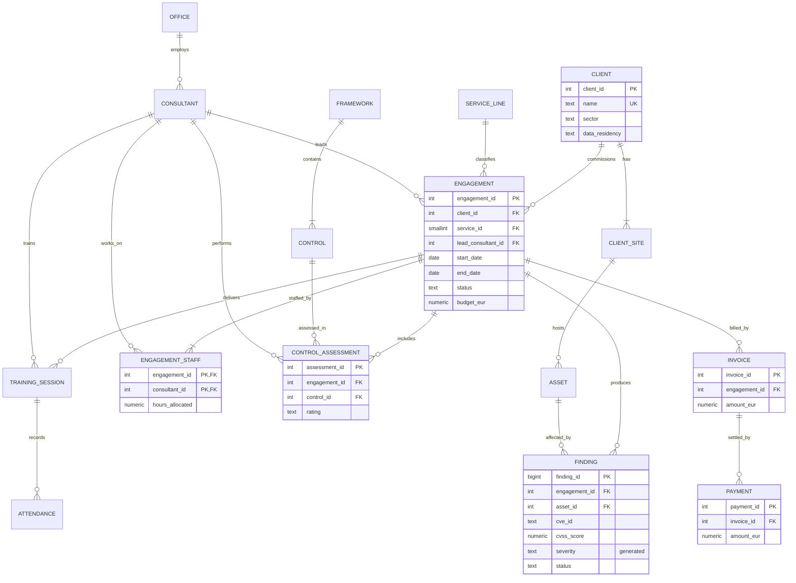

# Portfolio 1: Database Design and Modelling

**Case study:** TerraCyber Consulting, Engagement and Assurance Database (EAD)
**DBMS:** PostgreSQL 16
**Marks:** 7

## 1. What this portfolio delivers

| Evidence required by the brief | Where it is |
| --- | --- |
| Case study description | Section 2 below and the root [README](../README.md) |
| ER diagram | Section 3 (renders on GitHub) and `erd.dbml` (source for dbdiagram.io, exported as `erd.png`) |
| Relational schema | [`schema.sql`](schema.sql) |
| Keys and constraints | Section 4, tested by [`test_constraints.sql`](test_constraints.sql) |
| Normalisation explanation | Section 5 |
| Sample data | [`seed.sql`](seed.sql) (synthetic, deterministic) |

## 2. Case study in brief

TerraCyber Consulting is a multi-site cybersecurity consultancy serving NGOs, public bodies and private firms. It runs three service lines: compliance and data protection, advisory and resilience, and training and security awareness.

The EAD supports these operations:

- open an engagement for a client and staff it with consultants;
- record client assets and log vulnerability findings against them;
- assess a client against ISO/IEC 27001:2022, GDPR or NIST CSF 2.0 controls;
- deliver training sessions and record attendance and quiz scores;
- invoice engagements and record payments;
- keep an audit trail of every change to a finding.

## 3. ER diagram



The full attribute list for all 17 tables is in `erd.dbml`. Export it from dbdiagram.io as `erd.png` and commit the image.

`audit_log` has no foreign key on purpose. It must keep its history even after the row it describes is deleted.

## 4. Keys and constraints

**17 tables.** Every table has a primary key. Two tables use composite keys:

| Table | Primary key | Why composite |
| --- | --- | --- |
| `engagement_staff` | (engagement_id, consultant_id) | Resolves the many-to-many between consultants and engagements. A consultant appears once per engagement. |
| `attendance` | (session_id, participant_email) | A participant attends a session once. |

**Constraint types used:**

| Type | Examples | Business reason |
| --- | --- | --- |
| `UNIQUE` | consultant.email, invoice.invoice_no, (framework_id, ref_code) | No duplicate staff logins, invoice numbers or control codes |
| `FOREIGN KEY` | 19 references, `ON DELETE CASCADE` for child rows such as sites and attendance | Referential integrity |
| `CHECK` (domain) | sector, status, rating, role, asset_type | Only known values are stored |
| `CHECK` (range) | cvss_score 0 to 10, quiz_score 0 to 100, amounts > 0 | Rejects impossible numbers |
| `CHECK` (row rule) | end_date >= start_date; status `fixed` if and only if fixed_on is set | Keeps dates and status consistent |
| `CHECK` (pattern) | cve_id matches `^CVE-[0-9]{4}-[0-9]{4,}$` | Valid CVE identifiers only |
| Generated column | finding.severity from cvss_score | Severity cannot disagree with the score |
| Triggers | asset must belong to the engagement's client; payments cannot exceed invoice; audit of finding changes | Rules spanning several tables, which CHECK cannot express |

**Test evidence:** run `test_constraints.sql`. Each of its 11 statements breaks one rule and must fail.

```bash
psql -d ead -f test_constraints.sql 2>&1 | tee constraint-test-output.txt
```

## 5. Normalisation

### Starting point: the unnormalised spreadsheet (UNF)

Before a database, an engagement tracker in a spreadsheet often looks like this:

| Engagement | Client | Client country | Service | Staff | Findings |
| --- | --- | --- | --- | --- | --- |
| E-12 | Rhine Relief Network | DE | Compliance | Lena Weber (lead, 40h); Kofi Eze (analyst, 80h) | fw-01: TLS 1.0 (5.3, medium); srv-02: Log4Shell CVE-2021-44228 (10.0, critical) |

Problems: several staff and findings are packed in one cell, the client country repeats on every engagement row, and severity can contradict the score.

### First normal form (1NF)

Every cell holds one atomic value and there are no repeating groups. Staff and findings move to their own rows, giving `engagement_staff` and `finding`.

### Second normal form (2NF)

No non-key attribute depends on only part of a composite key. In `engagement_staff (engagement_id, consultant_id)`, `hours_allocated` depends on both keys. The consultant's name and email depend on `consultant_id` alone, so they move to `consultant`.

### Third normal form (3NF)

No non-key attribute depends on another non-key attribute:

- client name, sector and country depend on the client, not the engagement, so they live in `client`;
- the service name depends on `service_id`, so it lives in `service_line`;
- a site's city depends on the site, and the asset only references `site_id`;
- `severity` depends on `cvss_score`. Storing it as a normal column would break 3NF. It is a **generated column**, so the DBMS derives it and nobody can update it on its own.

### Deliberate exceptions

- `finding.engagement_id` and `finding.asset_id` both point towards the client. That is a redundant path, so a trigger enforces that they agree.
- `audit_log` stores JSON snapshots. It is a history table, not live data, so normal forms do not apply.

## 6. How to run and test

```bash
createdb ead
psql -d ead -f schema.sql
psql -d ead -f seed.sql            # loads data and prints row counts
psql -d ead -f test_constraints.sql
```

Seed data volumes (deterministic, `setseed(0.42)`):

| Table | Rows |
| --- | --- |
| client / client_site / asset | 20 / 50 / 850 |
| engagement / engagement_staff | 60 / 180 |
| finding | 66,240 |
| control / control_assessment | 124 / 2,196 |
| training_session / attendance | 60 / 1,200 |
| invoice / payment | 120 / 114 |

All names, organisations, hostnames and IP addresses in the seed data are fictitious. The CVE identifiers are real, public vulnerabilities used as realistic examples.

## 7. Evidence checklist

- [ ] `erd.png` exported from `erd.dbml`
- [ ] Screenshot of `\dt ead.*` listing the 17 tables
- [ ] Screenshot of the seed row counts
- [ ] `constraint-test-output.txt` showing the 11 expected errors
