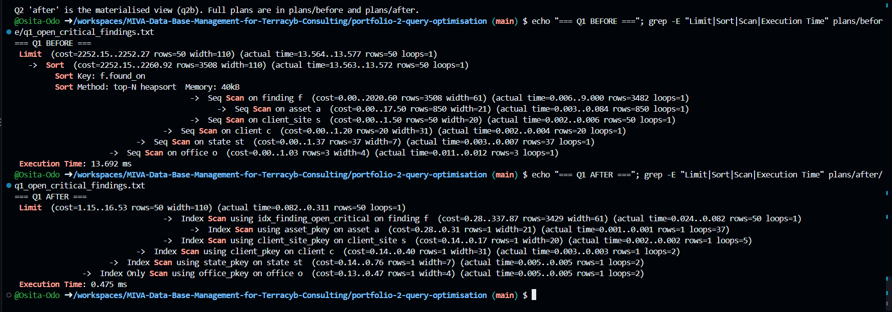
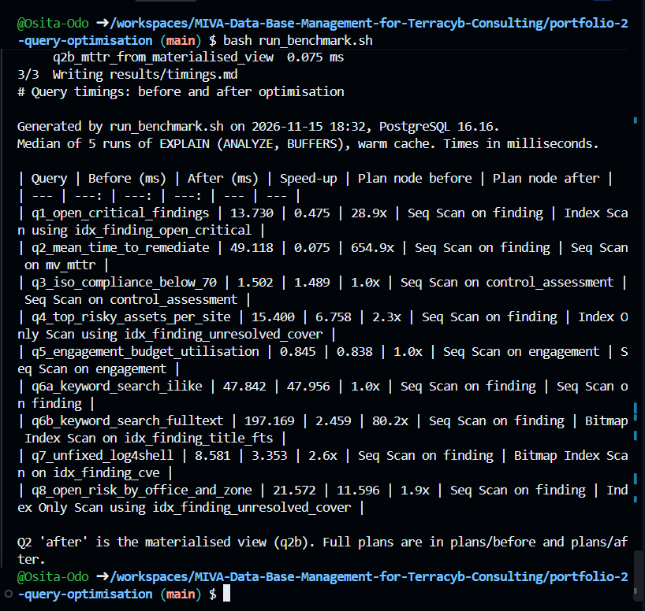
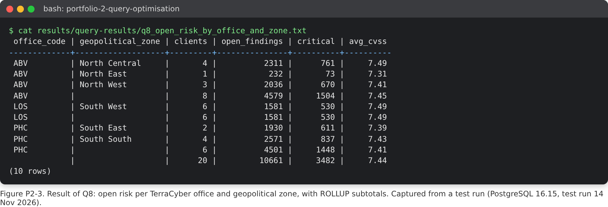

# Portfolio 2: Query Processing and Optimisation

**Case study:** TerraCyb Consulting EAD
**DBMS:** PostgreSQL 16
**Marks:** 7

## 1. What this portfolio delivers

| Evidence required by the brief | Where it is |
| --- | --- |
| SQL queries | [`queries/`](queries) (9 business queries, one file each) |
| Query results | `results/query-results/*.txt`, produced by `run_queries.sh` |
| Execution plans | `plans/before/` and `plans/after/`, produced by `run_benchmark.sh` |
| Indexing and optimisation evidence | [`indexes.sql`](indexes.sql), `results/timings.md`, [`join_strategies.sql`](join_strategies.sql) |
| Performance analysis | Section 4 below |
| Measured results and screenshots | Section 5: [`results/timings.md`](results/timings.md), [`screenshots/`](screenshots), [`plans/join-strategies.txt`](plans/join-strategies.txt) |

## Key decisions and reasons

Full register with alternatives: [docs/design-decisions.md](../docs/design-decisions.md).

| Decision | Reason | ID |
| --- | --- | --- |
| Each query answers a TerraCyb business question and shows a different SQL feature | Shows the database serving its purpose and covers joins, CTEs, window functions, ROLLUP and full-text search without repetition | D34 |
| One optimisation per plan problem (partial, covering, GIN, materialised view) | Each technique is matched to the specific reason the baseline plan was slow | D35 to D40 |
| No new index for Q3, Q5, Q6a and Q8 | Demonstrates when an index does not help or when an existing one is enough; every extra index slows writes | D37, D41 |
| Median of 5 warm runs, scripted drop and recreate | Resists outliers, is reproducible, and guarantees a fair before/after comparison | D42 |
| Join methods compared by planner settings | Isolates the effect of the join algorithm alone | D43 |

## In plain terms: what query optimisation means

When a query runs, PostgreSQL's **planner** chooses how to fetch the rows: read the whole table (a **sequential scan**), or use an **index**, a sorted lookup structure like the index at the back of a book. `EXPLAIN ANALYZE` shows the chosen plan and how long each step took. Optimisation means finding **why** a plan is slow and fixing that specific cause, rather than adding indexes everywhere.

Three kinds of fix appear in this portfolio:

- **An index** lets the planner jump to the rows it needs instead of reading all 66,240 findings. A *partial* index holds only the rows a query asks for; a *covering* index also holds the columns the query reads, so the table itself is never touched.
- **A materialised view** stores the result of an expensive query, so later reads are almost free. The trade-off is freshness: the result is only as current as the last refresh.
- **No change at all**, when the plan is already the cheapest one. Every index also slows down inserts and updates, so an index that does not help is a cost with no benefit.

## 2. The queries

Each query answers a question TerraCyb managers actually ask.

| # | Business question | SQL features shown |
| --- | --- | --- |
| Q1 | Which open critical findings have waited longest? (triage queue) | View over a 4-table join, filter, ORDER BY + LIMIT |
| Q2 | How many days do we take to fix findings, per service line and quarter? | GROUP BY on an expression, AVG on date arithmetic |
| Q3 | Which clients are below 70% ISO/IEC 27001 compliance? | CTE, `FILTER` conditional aggregates, HAVING |
| Q4 | What are the 5 riskiest assets at each client site? | Window function `RANK() OVER (PARTITION BY ...)` |
| Q5 | How does planned staff cost compare with each engagement's budget? | LEFT JOINs, derived table, COALESCE, NULLIF |
| Q6a | How many findings mention "password"? (ILIKE) | Pattern matching with a leading wildcard |
| Q6b | Same question with full-text search | `to_tsvector` / `to_tsquery` |
| Q7 | Where is Log4Shell (CVE-2021-44228) still unfixed? | Selective equality lookup |
| Q8 | How much open risk does each office (Lagos, Abuja, Port Harcourt) carry, by geopolitical zone? | 6-table join through the `state` lookup, `GROUP BY ROLLUP` subtotals |

## 3. How to run

Load Portfolio 1 first (`schema.sql`, then `seed.sql`). Then:

```bash
./run_queries.sh          # saves each result set to results/query-results/
./run_benchmark.sh        # drops optimisations, times every query, creates them, times again
psql -d ead -f join_strategies.sql > plans/join-strategies.txt
```

`run_benchmark.sh` takes the median of 5 runs of `EXPLAIN (ANALYZE, BUFFERS)` with a warm cache. It writes the full plans and a summary table to `results/timings.md`. Both scripts read the usual `PGHOST`, `PGUSER` and `PGPASSWORD` environment variables.

## 4. Optimisations and analysis

The `finding` table holds about 66,000 rows. Without Portfolio 2 indexes, every query on it starts with a sequential scan. Each optimisation targets one specific plan problem.

| Query | Problem in the baseline plan | Optimisation | Expected result |
| --- | --- | --- | --- |
| Q1 | Scans all findings, then sorts about 3,500 rows to return 50 | **Partial index** on `found_on`, limited to open or in-progress critical findings | Index Scan returns rows already in order and stops after 50. Largest gain among the B-tree cases. |
| Q2 | Aggregates about 50,000 fixed findings on every run | **Materialised view** `mv_mttr` plus a unique index | Reading a few dozen precomputed rows. Trade-off: data is only as fresh as the last `REFRESH MATERIALIZED VIEW`. |
| Q3 | About 2,200 rows in `control_assessment` | **None added** | No real change. With a small table that the query reads mostly in full, a sequential scan is already the cheapest plan. |
| Q4 | Reads every finding to sum unresolved CVSS | **Covering partial index** `(asset_id) INCLUDE (cvss_score)` on unresolved rows | Index Only Scan reads a smaller structure and never visits the table. Moderate gain, because the aggregation still has to run. |
| Q5 | Small tables, hash joins | **None.** Join algorithms compared in `join_strategies.sql` | Planner picks hash joins. Forcing merge join or nested loops gives slower or equal plans at this size. |
| Q6a | `ILIKE '%password%'` cannot use a B-tree | **None for ILIKE** | Stays a sequential scan. A B-tree only helps for left-anchored patterns such as `'password%'`. |
| Q6b | `to_tsvector` is computed for every row on every run | **GIN expression index** on `to_tsvector('english', title)` | Bitmap Index Scan on the GIN index. The biggest single improvement after Q2. |
| Q7 | Equality filter on a rare value, but a full scan | **Partial B-tree** on `cve_id` where it is not null | Bitmap Index Scan. Index stays small because most findings have no CVE. |
| Q8 | Scans all findings to keep the unresolved ones, then joins through `state` to the office | **Reuses** the Q4 covering partial index | Shows that one well-chosen index can serve several queries. Compare the before and after plans to see whether the planner chose it. |

**Points to write about in your own words after running the benchmark:**

1. Compare the planner's estimated `rows=` with the `actual ... rows=` in each plan. Note where they differ and why (for example the correlation between `status` and `severity` in query 4 of `join_strategies.sql`).
2. Explain why Q3, Q5 and Q6a did not improve. Knowing when an index does not help is part of the marks for performance analysis.
3. Consider the cost side: every index slows `INSERT` and `UPDATE` on `finding` and uses disk. Check sizes with:

```sql
SELECT indexrelname, pg_size_pretty(pg_relation_size(indexrelid))
FROM pg_stat_user_indexes WHERE relname = 'finding';
```

4. Optional extension: `CREATE EXTENSION pg_trgm;` and a GIN trigram index make Q6a's `ILIKE '%password%'` indexable. Rerun and compare.

## 5. Results

Measured with `run_benchmark.sh` in a test run on 14 November 2026: PostgreSQL 16.15, 2 virtual CPUs (Intel Xeon, 2.30 GHz), 7 GB RAM. The raw output is [`results/timings.md`](results/timings.md); full plans are in [`plans/before/`](plans/before) and [`plans/after/`](plans/after). Timings vary between machines; the ratios matter more than the absolute times.

| Query | Before (ms) | After (ms) | Speed-up | Access path after | Why |
| --- | ---: | ---: | ---: | --- | --- |
| Q1 | 11.571 | 0.371 | 31.2x | Index Scan using `idx_finding_open_critical` | Partial index holds only open critical findings, already sorted; the planner stops after 50 rows instead of sorting about 3,500 |
| Q2 | 30.791 | 0.061 | 504.8x | Seq Scan on `mv_mttr` (materialised view) | Reads a few dozen precomputed rows instead of aggregating about 50,000 |
| Q3 | 1.113 | 1.476 | 0.8x | Seq Scan on `control_assessment` | No index added on purpose: a small table read almost entirely; the difference is run-to-run noise |
| Q4 | 10.590 | 4.759 | 2.2x | Index Only Scan using `idx_finding_unresolved_cover` | Covering index answers the query without reading the table; the aggregation still has to run |
| Q5 | 0.709 | 0.605 | 1.2x | Seq Scan on `engagement` | No index added on purpose: small tables, hash joins already cheapest |
| Q6a | 32.098 | 31.789 | 1.0x | Seq Scan on `finding` | `ILIKE '%password%'` cannot use a B-tree index because of the leading wildcard |
| Q6b | 115.507 | 2.193 | 52.7x | Bitmap Index Scan on `idx_finding_title_fts` | GIN index replaces computing `to_tsvector` for every title |
| Q7 | 5.774 | 3.202 | 1.8x | Bitmap Index Scan on `idx_finding_cve` | Partial index on the CVE column; small, because most findings have no CVE |
| Q8 | 14.319 | 8.169 | 1.8x | Index Only Scan using `idx_finding_unresolved_cover` | Reuses the Q4 index: one well-chosen index serves several queries |

**Interpretation (from the test run; rewrite in your own words after your own run):** the largest gains come where the slow part of the plan is reading or sorting rows the query does not need: Q1's partial index removes the sort, Q6b's GIN index removes per-row text processing, and Q2's materialised view removes the aggregation entirely. Covering and partial indexes (Q4, Q7, Q8) roughly halve the time because the remaining work, joining and aggregating, is unchanged. Q3, Q5 and Q6a show the other half of the analysis: on small tables, or with a leading-wildcard pattern, no index helps, and adding one would only slow down writes.

### Screenshots

**Q1 before and after the partial index.** Before: a sequential scan of `finding`, then a sort. After: an index scan that returns rows already in order:



**The benchmark run** (drop optimisations, time every query, create them, time again):



**A query result: Q8, open risk per office and zone,** with ROLLUP subtotal rows (zone empty) and a grand total (office and zone empty):



## 6. Evidence checklist

- [x] `results/query-results/` committed (test run)
- [x] `plans/before/` and `plans/after/` committed (test run)
- [x] `results/timings.md` committed and copied into section 5
- [x] Screenshot of one before/after plan pair ([Q1](screenshots/01-q1-plan-before-after.png))
- [x] `plans/join-strategies.txt` committed
- [ ] Re-run on your own machine, update section 5 with your timings and hardware, and rewrite the interpretation in your own words
