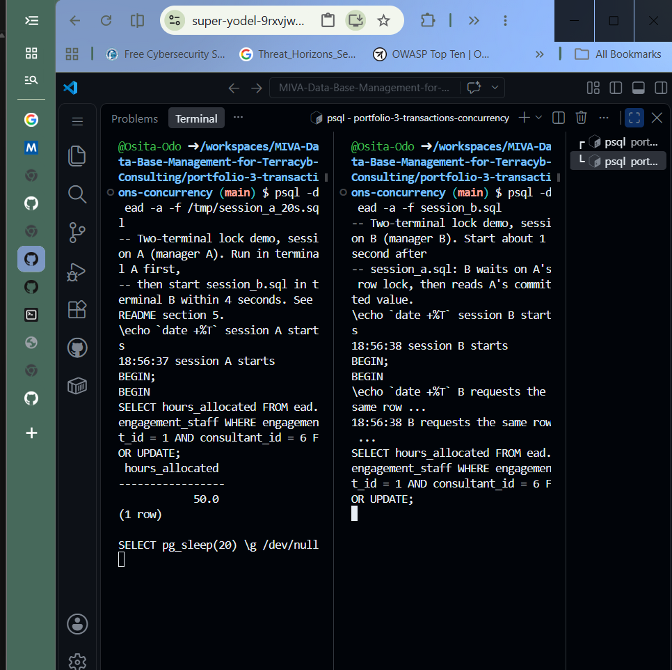
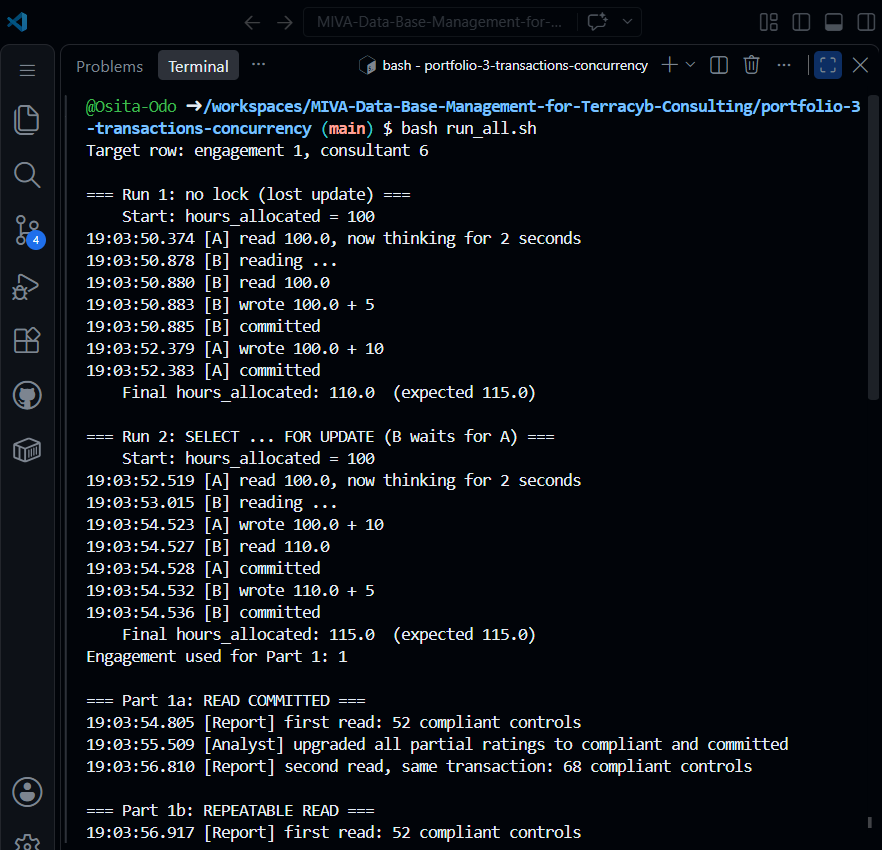
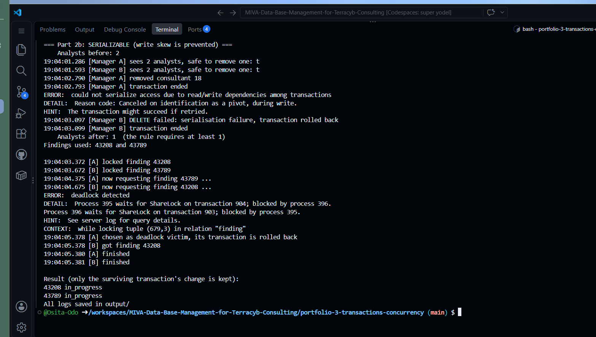
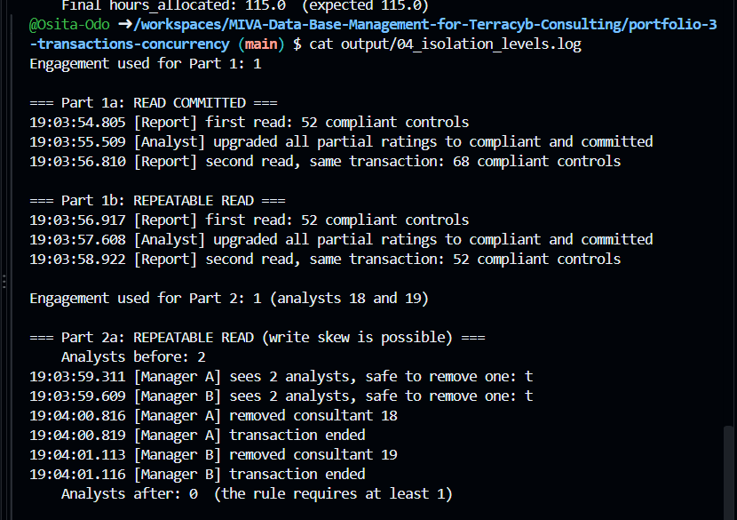
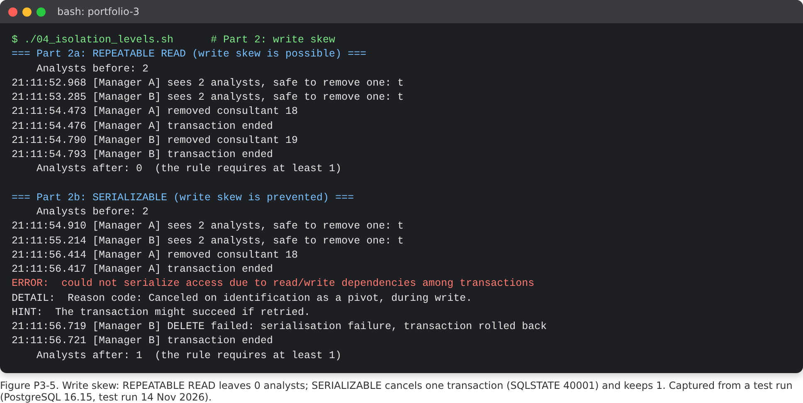
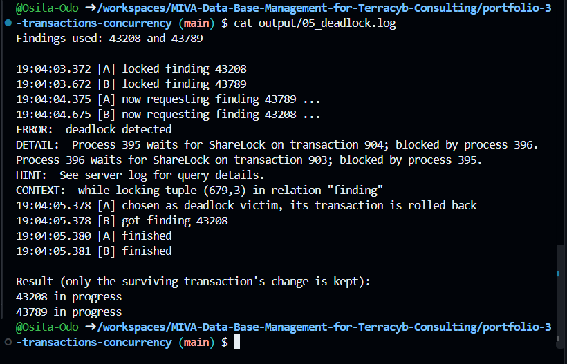

# Portfolio 3: Transactions and Concurrency

**Case study:** TerraCyb Consulting EAD
**DBMS:** PostgreSQL 16 (default isolation level: READ COMMITTED)
**Marks:** 7

## 1. What this portfolio delivers

| Evidence required by the brief | Scenario | File |
| --- | --- | --- |
| Commit | 1. Close a finding and audit it atomically | [`01_commit_close_finding.sql`](01_commit_close_finding.sql) |
| Rollback | 2. Reject an overpayment; SAVEPOINT variant | [`02_rollback_overpayment.sql`](02_rollback_overpayment.sql) |
| Concurrency issue and control mechanism | 3. Lost update, fixed with `SELECT ... FOR UPDATE` | [`03_lost_update.sh`](03_lost_update.sh) |
| Isolation | 4. Non-repeatable read and write skew across isolation levels | [`04_isolation_levels.sh`](04_isolation_levels.sh) |
| Concurrency control (extra) | 5. Deadlock detection | [`05_deadlock.sh`](05_deadlock.sh) |
| Output evidence | Logs of every run | [`output/`](output) |
| Two-terminal demonstration | Manual lock wait in two sessions, plus a monitor | [`session_a.sql`](session_a.sql), [`session_b.sql`](session_b.sql), [`monitor.sql`](monitor.sql) |
| Screenshots | All five scenarios | Section 5, [`screenshots/`](screenshots) |

## Key decisions and reasons

Full register with alternatives: [docs/design-decisions.md](../docs/design-decisions.md).

| Decision | Reason | ID |
| --- | --- | --- |
| Scenarios built on TerraCyb operations (closing findings, payments, staffing, compliance reports) | Each brief requirement is evidenced with a realistic case rather than an abstract example | D44 |
| Two scripted sessions timed with `pg_sleep` | Forces the same interleaving every time, so the logs are reproducible evidence | D45 |
| `SELECT ... FOR UPDATE` to fix the lost update | The manager reads the hours before deciding; a row lock protects exactly this read-decide-write pattern | D46 |
| SERIALIZABLE to stop write skew | The two managers update different rows, so ordinary row locks never conflict; SERIALIZABLE detects the pattern anyway | D47 |
| Deadlock scenario with ordered locking as the fix | Row locks (D46) create deadlock risk; the scenario shows both detection and prevention | D48 |
| Scripts restore the rows they change | Scenarios can be rerun in any order with the same results | D49 |

## In plain terms: what a transaction is

A **transaction** groups several changes so they succeed or fail together. The four guarantees are known as **ACID**:

| Property | Meaning |
| --- | --- |
| Atomicity | All changes happen, or none do |
| Consistency | The rules (constraints, triggers) hold before and after |
| Isolation | Users working at the same time do not see each other's half-finished work |
| Durability | Once committed, a change survives a crash |

When two people work on the same data at the same moment, things can go wrong in specific, named ways: a **lost update** (one change overwrites another), a **non-repeatable read** (the same question gives two answers inside one transaction), **write skew** (two changes that are each fine break a rule together) and a **deadlock** (two transactions each wait for the other forever). Each scenario below makes one of these happen on purpose, then shows the mechanism that prevents it.

| Scenario | What happens | Result and lesson |
| --- | --- | --- |
| 1. COMMIT | A finding is closed; the audit trigger writes a log row in the same transaction | Both changes are saved together, or neither |
| 2. ROLLBACK and SAVEPOINT | A valid payment, then one that would overpay the invoice | Without a savepoint, ROLLBACK undoes both; with one, only the bad step is undone and the invoice shows "part paid" |
| 3. Lost update | Two managers add 10 and 5 hours to the same consultant at the same moment | Without a lock the total is 110 (one change lost); with `SELECT ... FOR UPDATE` it is the correct 115 |
| 4. Isolation levels | A report counts compliant controls twice while an analyst updates them; two managers each remove a different analyst | READ COMMITTED gave 52 then 68; REPEATABLE READ gave 52 both times. Only SERIALIZABLE stopped the managers leaving an engagement with no analyst |
| 5. Deadlock | Two analysts lock the same two findings in opposite order | PostgreSQL detects the cycle and cancels one; prevention: always lock rows in the same order |

## 2. How to run

Load Portfolio 1 first. Then run everything at once:

```bash
./run_all.sh            # writes output/01 ... output/05 logs
```

Or run one scenario at a time:

```bash
psql -d ead -f 01_commit_close_finding.sql
psql -d ead -f 02_rollback_overpayment.sql
./03_lost_update.sh
./04_isolation_levels.sh
./05_deadlock.sh
```

Scenarios 3 to 5 start two `psql` sessions in parallel and use `pg_sleep` to force a precise interleaving, so the result is the same on every run. Each line is timestamped so the order of events is visible. The scripts restore the rows they change. Scenarios 1 and 2 change one finding and one invoice each time they run.

## 3. Scenarios and what they prove

### Scenario 1: COMMIT (atomicity and durability)

Closing a finding changes `finding.status` and `fixed_on`. Trigger `trg_audit_finding` writes an `audit_log` row in the same transaction. After `COMMIT` both changes are permanent. Before it, no other session can see either.

### Scenario 2: ROLLBACK and SAVEPOINT (atomicity and consistency)

Trigger `trg_payment_within_invoice` raises an error if total payments would exceed the invoice.

- **Part A:** the first payment is valid, the second is not. The error puts the whole transaction into an aborted state; even `SELECT 1` is refused. `ROLLBACK` removes the valid first payment too, because a transaction is all or nothing.
- **Part B:** a `SAVEPOINT` after the first payment lets `ROLLBACK TO SAVEPOINT` discard only the failed step. The commit keeps half the payment and the invoice moves to `part_paid`.

The trigger also locks the invoice row (`FOR UPDATE`), so two concurrent payments cannot both pass the check.

### Scenario 3: Lost update and row locking

Two managers add hours to the same consultant: A adds 10, B adds 5. Both read 100.

| Run | Mechanism | Final value | Why |
| --- | --- | --- | --- |
| 1 | Plain `SELECT`, then `UPDATE` | 110 (B's +5 lost) | A wrote a value calculated from a stale read |
| 2 | `SELECT ... FOR UPDATE` | 115 (correct) | B blocks on the row lock until A commits, then reads 110 |

Another valid fix is an atomic update: `SET hours_allocated = hours_allocated + 5`.

### Scenario 4: Isolation levels

**Part 1, non-repeatable read.** A compliance report reads the number of compliant controls twice in one transaction. Between the reads, an analyst upgrades ratings and commits.

| Isolation level | First read | Second read | Explanation |
| --- | --- | --- | --- |
| READ COMMITTED | 52 | 68 | Each statement sees a fresh snapshot |
| REPEATABLE READ | 52 | 52 | The whole transaction uses one snapshot |

**Part 2, write skew.** Rule: an engagement must keep at least one analyst. Two managers each check "more than one analyst?" and then remove a *different* analyst. They update different rows, so row locks never conflict.

| Isolation level | Outcome |
| --- | --- |
| REPEATABLE READ | Both commit; 0 analysts remain. The rule is broken. |
| SERIALIZABLE | One transaction fails with `could not serialize access due to read/write dependencies` (SQLSTATE 40001); 1 analyst remains. |

Applications using SERIALIZABLE must catch SQLSTATE 40001 and retry the transaction.

### Scenario 5: Deadlock

Session A locks finding 1 then asks for finding 2. Session B locks finding 2 then asks for finding 1. After `deadlock_timeout` (1 second), PostgreSQL detects the cycle, aborts one session (`ERROR: deadlock detected`) and lets the other finish. To prevent deadlocks, always lock rows in a fixed order, for example `ORDER BY finding_id`.

## 4. ACID summary

| Property | Where it is shown |
| --- | --- |
| Atomicity | Scenario 1 (finding and audit row together); Scenario 2 Part A (all or nothing) |
| Consistency | Scenario 2 (trigger rule); Scenario 4 Part 2 (business rule kept only under SERIALIZABLE) |
| Isolation | Scenarios 3 and 4 (locks and snapshot levels) |
| Durability | Scenario 1 (committed change still there in a new session; `audit_log` timestamp) |

## 5. Screenshots

The screenshots below are screen captures from my own run in GitHub Codespaces on 15 November 2026 (PostgreSQL 16 in Docker). Each one shows the command that was run and its unedited output; the full logs are in [`output/`](output). The times shown are UTC.

### 5.1 Two terminals: a row lock in action

This is the brief's "two terminals side by side" evidence. It was run live with two real `psql` sessions in two split terminals, using [`session_a.sql`](session_a.sql) and [`session_b.sql`](session_b.sql):

1. Reset the row to 50 hours (the line at the end of `session_b.sql`).
2. In terminal A, start session A. Manager A locks the row with `SELECT ... FOR UPDATE` and holds the lock. For this run the hold was lengthened from 4 to 20 seconds with a temporary copy, so there was time to start B by hand: `sed 's/pg_sleep(4)/pg_sleep(20)/; s/for 4 s/for 20 s/' session_a.sql > /tmp/session_a_20s.sql`.
3. While A holds the lock, in terminal B, start `psql -d ead -a -f session_b.sql`. Manager B asks for the same row and **waits**.
4. When A commits, B continues immediately and reads A's new value, so neither change is lost.

**While B is waiting.** A (left) started at 18:56:37 and is inside `pg_sleep`; B (right) started at 18:56:38 and its `SELECT ... FOR UPDATE` has no result yet:



**After A commits.** The complete run in both terminals:


| Time (UTC) | Manager A (left) | Manager B (right) |
| --- | --- | --- |
| 18:56:37 | Starts, locks the row, reads 50.0 | |
| 18:56:38 | Holds the lock | Starts, requests the same row, waits |
| 18:56:57 | Adds 10, commits | Gets the lock in the same second, reads 60.0 (not the stale 50.0), adds 5 |
| | | Final value 65.0 = 50 + 10 + 5 |

B waited 19 seconds and was released the moment A's transaction ended, which shows the row lock serialising the two managers.

A first attempt is worth noting: when B was started after A had already committed, B got the row at once and no wait occurred. The lock only matters while both transactions overlap, which is exactly the situation a lost update needs.

### 5.2 The scripted scenarios

`run_all.sh` runs all five scenarios and saves their logs:





**Scenario 3, lost update.** Without a lock both managers read 100.0 and the total is 110.0 (B's +5 is overwritten by A); with `FOR UPDATE`, B waits, reads 110.0 and the total is 115.0:


**Scenario 4, Part 1, non-repeatable read.** Under READ COMMITTED the report reads 52 and then 68 compliant controls inside one transaction; under REPEATABLE READ it reads 52 both times. Part 2a is also visible: under REPEATABLE READ both managers remove an analyst and 0 remain:



**Scenario 4, Part 2, write skew.** Under SERIALIZABLE, PostgreSQL cancels Manager B with SQLSTATE 40001 ("could not serialize access due to read/write dependencies") and 1 analyst remains:



**Scenario 5, deadlock.** A and B lock findings 43208 and 43789 in opposite order. PostgreSQL detects the cycle about one second later, chooses session A as the victim and rolls it back; session B completes:



**Additional screenshots** (also in [`docs/TerraCyb_Screenshot_Evidence.docx`](../docs/TerraCyb_Screenshot_Evidence.docx)):

- [`00-two-terminals-setup.png`](screenshots/00-two-terminals-setup.png): the two split terminals being prepared
- [`08-first-attempt-no-wait.png`](screenshots/08-first-attempt-no-wait.png): the first attempt, in which B started after A had committed, so no wait occurred
- [`01c-lock-wait-completed-narrow.png`](screenshots/01c-lock-wait-completed-narrow.png): the successful run in the narrower split view
- [`09-pushed-output.png`](screenshots/09-pushed-output.png): output committed and pushed from the codespace

## 6. Evidence checklist

- [x] `output/01` to `output/05` logs committed (my Codespaces run)
- [x] Two-terminal screenshots of the lock wait, during and after ([section 5.1](#51-two-terminals-a-row-lock-in-action))
- [x] Screenshot of the SERIALIZABLE error from Scenario 4 ([screenshot](screenshots/05-serializable-write-skew.png))
- [x] Screenshot of the deadlock error from Scenario 5 ([screenshot](screenshots/06-deadlock.png))
- [x] Run myself in two real terminals (15 November 2026)
