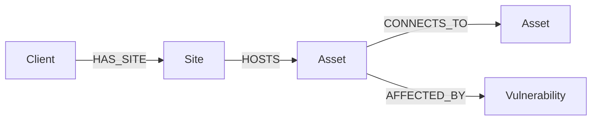

# Portfolio 4: NoSQL and Advanced Data Models

**Case study:** TerraCyb Consulting EAD
**Technologies:** MongoDB 7 (document model), Neo4j 5 (graph model)
**Marks:** 7

## 1. What this portfolio delivers

| Evidence required by the brief | Where it is |
| --- | --- |
| NoSQL model based on the same case study | Section 2: audit evidence as documents, network exposure as a graph |
| Document example | [`mongo/`](mongo): collection with a `$jsonSchema` validator, 3,006 documents, queries, aggregation, indexes |
| Graph example | [`graph/`](graph): assets, vulnerabilities and network paths in Neo4j |
| Implementation evidence | `evidence-samples/*.txt` outputs and screenshots (section 4) |
| Explanation of suitability | Section 5 |

## Key decisions and reasons

Full register with alternatives: [docs/design-decisions.md](../docs/design-decisions.md).

| Decision | Reason | ID |
| --- | --- | --- |
| MongoDB for audit evidence | Evidence types have different shapes; one flexible document per item fits them, with aggregation and array updates built in | D07, D50 |
| Embed scan results; reference engagements by id | Results are read only with their scan; engagement data changes and belongs in PostgreSQL | D51 |
| Validate only shared fields | Shared fields must be consistent for queries; type-specific fields stay flexible | D52 |
| 3,000 generated documents | Index effects are invisible on a handful of documents | D53 |
| Hostnames exported from PostgreSQL | All stores describe the same assets, as a real polyglot system must | D54 |
| Neo4j for attack paths, one client only | Multi-hop paths are one Cypher pattern but a recursive CTE in SQL; one client keeps the graph readable | D08, D56 |
| Entry points: internet-facing with CVSS 9 or more | Matches the "critical" severity threshold and realistic attacker access | D57 |

## In plain terms: why use more than one kind of database

A relational database is excellent at data that fits neat tables and must stay consistent, such as clients, engagements and payments. Some data does not fit tables well. **NoSQL** databases store data in other shapes, and using several kinds of database side by side, each for the data it suits, is called **polyglot persistence**.

- **MongoDB (documents):** each piece of audit evidence is one self-contained document, like a JSON file. A scan report and an interview note can sit in the same collection even though their fields are completely different.
  - **Embedded:** scan results sit inside their scan document, because they are always read together.
  - **Referenced:** engagement and client are stored only as ids, because their details live in PostgreSQL and change there.
  - **Validated:** a schema validator checks the fields every evidence type shares, and leaves type-specific fields flexible.
  - **Measured:** 3,006 documents, so the effect of indexes is visible: before indexing every document is examined; after, only the matching ones.
- **Neo4j (graph):** client machines are **nodes** and network links are **relationships**. "Can an attacker get from an exposed server to a critical system?" becomes one short query that follows the links, where SQL would need a recursive query that grows with each hop. The graph models one client, Lagoon Community Food Network in Lagos: 13 assets, 4 real CVEs and 12 network links.

| Need | Relational | Document | Graph |
| --- | --- | --- | --- |
| Engagements, invoices, payments | **Best** | Weak | Not suitable |
| Evidence with varying structure | Awkward | **Best** | Not suitable |
| Multi-hop network paths | Slow as hops grow | Limited | **Best** |

## 2. Why NoSQL here: polyglot persistence

PostgreSQL stays the **system of record** for engagements, findings, controls and money. Two kinds of TerraCyb data fit it badly:

1. **Audit evidence.** A vulnerability scan, a policy PDF's metadata, a firewall configuration and an interview note have completely different structures. In SQL this needs many sparse tables or an untyped blob.
2. **Network exposure.** "Can an attacker get from this internet-facing server to the finance database?" is a path question over many hops.

The two stores link back to PostgreSQL through shared keys: every evidence document carries `engagement_id` and `client_id`. Hostnames and IP addresses in both MongoDB and Neo4j are exported from the PostgreSQL `asset` table (`mongo/export_assets.sh`).

## 3. Models

### 3.1 Document model (MongoDB), collection `evidence`

One document per piece of evidence. Shared fields are validated; type-specific fields are free.

| Field | All types | Only some types |
| --- | --- | --- |
| `_id` (`EV-YYYY-NNNNN`), `engagement_id`, `client_id`, `control_ref`, `type`, `collected_by`, `collected_at`, `tags[]` | Yes | |
| `scanner{}`, `results[]` (host, ip, port, cve, cvss, status) | | `vuln_scan` |
| `document{}`, `review{}` | | `policy_document` |
| `device{}`, `firewall_rules[]`, `issues[]` | | `config_snapshot` |
| `questions[]`, `conclusion` | | `interview_note` |
| `image{}`, `caption` | | `screenshot` |

**Design decisions:**

- Scan results are **embedded** in the scan document. They are always read with their scan and never shared, and one document stays far below MongoDB's 16 MB limit.
- Engagement and client details are **referenced** by id, not copied. They change and they live in PostgreSQL.
- A `$jsonSchema` validator rejects documents with an unknown `type` or a CVSS outside 0 to 10. That is schema-on-write for what must be consistent, and flexibility for the rest.

Example (shortened):

```json
{
  "_id": "EV-2026-00001",
  "engagement_id": 1,
  "client_id": 1,
  "control_ref": "ISO27001:A.8.8",
  "type": "vuln_scan",
  "collected_by": "consultant18",
  "collected_at": "2026-03-02T09:14:00Z",
  "scanner": { "name": "OpenVAS", "version": "23.1" },
  "results": [
    { "host": "lagoon-1-010", "ip": "10.1.0.11", "port": 443,
      "cve": "CVE-2021-44228", "cvss": 10.0, "status": "open" }
  ],
  "tags": ["perimeter", "external-scan"]
}
```

### 3.2 Graph model (Neo4j)



| Node | Properties |
| --- | --- |
| `Client` | client_id, name, sector |
| `Site` | site_id, name |
| `Asset` | hostname (unique), ip, asset_type, criticality, internet_facing |
| `Vulnerability` | cve (unique), name, cvss |

The graph covers client 1 (Lagoon Community Food Network, an NGO with a head office and a data-centre site in Lagos): 13 assets, 4 CVEs, 12 network links.

## 4. How to run

```bash
docker compose up -d

# MongoDB
./mongo/export_assets.sh                       # needs the Portfolio 1 database; assets.json is already committed
docker exec -it tc-mongo mongosh terracyb /scripts/01_create_collection.js
docker exec -it tc-mongo mongosh terracyb /scripts/02_load_evidence.js
docker exec -it tc-mongo mongosh terracyb /scripts/03_queries.js > evidence-samples/mongo-output.txt

# Neo4j
docker exec tc-neo4j cypher-shell -u neo4j -p terracyb-demo -f /scripts/01_create_graph.cypher
docker exec tc-neo4j cypher-shell -u neo4j -p terracyb-demo -f /scripts/02_attack_paths.cypher > evidence-samples/neo4j-output.txt
```

Open http://localhost:7474 and run `MATCH (n) RETURN n` to see the graph. Screenshot it for the LMS.

### MongoDB operations (`03_queries.js`)

| # | Operation | Feature |
| --- | --- | --- |
| Q1 | Evidence for one engagement and control, newest first | find, projection, sort, limit |
| Q2 | Scans with an open RDP result scoring 8 or more | `$elemMatch` inside an array |
| Q3 | Top 10 hosts by open high or critical results | Aggregation: `$unwind`, `$group`, `$addToSet`, `$sort` |
| Q4 | Evidence coverage per control | Aggregation by control and type |
| Q5 | Mark Log4Shell results as fixed | `updateMany` with `arrayFilters` |
| Indexes | Compound, multikey (`results.cve`) and text indexes | `explain("executionStats")` before and after |

The script prints the plan stages and `docsExamined` before and after indexing. Before: `COLLSCAN`, all 3,006 documents examined. After: `IXSCAN`, only matching documents examined.

### Neo4j queries (`02_attack_paths.cypher`)

| # | Question |
| --- | --- |
| G1 | Every path from an exploitable internet-facing asset to a critical asset, within 4 hops |
| G2 | Shortest path from each entry point to cloud asset `lagoon-2-009` in the Lagos data centre |
| G3 | Blast radius: assets reachable within 3 hops of each entry point |
| G4 | Choke points: internal assets on the most attack paths (best places to segment) |

## 5. Suitability: which model for which job

| Need | Relational (PostgreSQL) | Document (MongoDB) | Graph (Neo4j) |
| --- | --- | --- | --- |
| Engagements, invoices, payments | **Best:** joins, constraints, ACID across tables | Weak: no cross-document constraints | Not suitable |
| Evidence with varying structure | Many sparse tables or JSONB | **Best:** one flexible document per item, validated core | Not suitable |
| Nested scan results | Child table, join on every read | **Best:** embedded and read in one go | Possible, but heavy |
| Multi-hop network paths | Recursive CTE; slows as hops grow | `$graphLookup` exists but is limited | **Best:** variable-length paths, shortest path |
| Horizontal scale for large scan volumes | Harder (see Portfolio 5) | Built-in sharding | Clustering in Enterprise edition |

**Graph vs SQL for G1.** In SQL, G1 needs a recursive CTE that joins an `asset_link` table to itself once per hop, with cycle detection. In Cypher it is one pattern: `(entry)-[:CONNECTS_TO*1..4]->(target)`. The graph engine follows stored relationships directly (index-free adjacency). It does not search a join index at each step.

**PostgreSQL JSONB as an alternative.** PostgreSQL could store evidence in a `JSONB` column with a GIN index. That would avoid a second database. MongoDB still wins here for aggregation pipelines over arrays, built-in sharding, and partial updates such as `arrayFilters`. Mention this trade-off in your reflection.

## 6. Evidence checklist

**Status:** these items need Docker on your own machine. The MongoDB and Neo4j images could not be downloaded in the test environment used for the other portfolios, so no outputs or screenshots have been added here yet. The scripts were checked for syntax, and the MongoDB loader was tested against a MongoDB-compatible test server.

- [ ] `evidence-samples/mongo-output.txt`, including the validator rejection and before/after explain summaries
- [ ] `evidence-samples/neo4j-output.txt`
- [ ] Screenshot of MongoDB Compass or mongosh showing a scan document
- [ ] Screenshot of the Neo4j Browser graph, ideally the G1 paths highlighted
