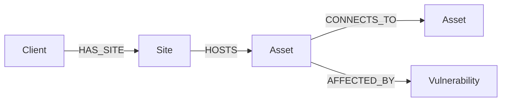
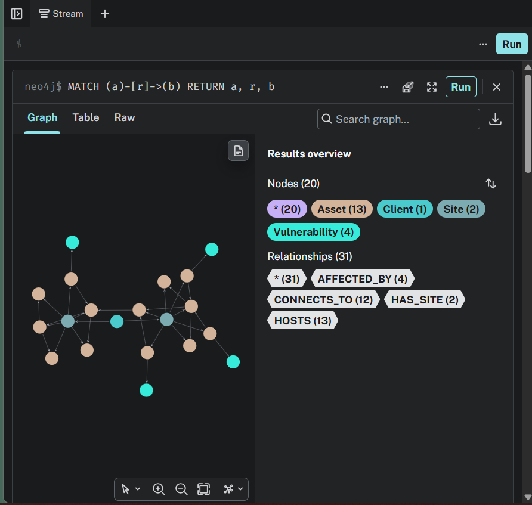
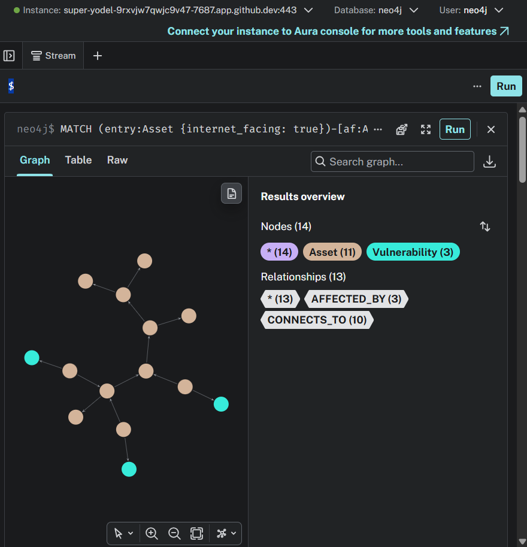

# Portfolio 4: NoSQL and Advanced Data Models

**Case study:** TerraCyb Consulting EAD
**Technologies:** MongoDB 7 (document model), Neo4j 5 (graph model)
**Marks:** 7

## 1. What this portfolio delivers

| Evidence required by the brief | Where it is |
| --- | --- |
| NoSQL model based on the same case study | Section 2: audit evidence as documents, network exposure as a graph |
| Document example | [`mongo/`](mongo): collection with a `$jsonSchema` validator, 3,006 documents, queries, aggregation, indexes |
| Graph example | [`graph/`](graph): assets, vulnerabilities and network paths in Neo4j |
| Implementation evidence | `evidence-samples/*.txt` outputs and 12 screenshots (section 6) |
| Explanation of suitability | Section 5 |

## Key decisions and reasons

Full register with alternatives: [docs/design-decisions.md](../docs/design-decisions.md).

| Decision | Reason | ID |
| --- | --- | --- |
| MongoDB for audit evidence | Evidence types have different shapes; one flexible document per item fits them, with aggregation and array updates built in | D07, D50 |
| Embed scan results; reference engagements by id | Results are read only with their scan; engagement data changes and belongs in PostgreSQL | D51 |
| Validate only shared fields | Shared fields must be consistent for queries; type-specific fields stay flexible | D52 |
| 3,000 generated documents | Index effects are invisible on a handful of documents | D53 |
| Hostnames exported from PostgreSQL | All stores describe the same assets, as a real polyglot system must | D54 |
| Neo4j for attack paths, one client only | Multi-hop paths are one Cypher pattern but a recursive CTE in SQL; one client keeps the graph readable | D08, D56 |
| Entry points: internet-facing with CVSS 9 or more | Matches the "critical" severity threshold and realistic attacker access | D57 |

## In plain terms: why use more than one kind of database

A relational database is excellent at data that fits neat tables and must stay consistent, such as clients, engagements and payments. Some data does not fit tables well. **NoSQL** databases store data in other shapes, and using several kinds of database side by side, each for the data it suits, is called **polyglot persistence**.

- **MongoDB (documents):** each piece of audit evidence is one self-contained document, like a JSON file. A scan report and an interview note can sit in the same collection even though their fields are completely different.
  - **Embedded:** scan results sit inside their scan document, because they are always read together.
  - **Referenced:** engagement and client are stored only as ids, because their details live in PostgreSQL and change there.
  - **Validated:** a schema validator checks the fields every evidence type shares, and leaves type-specific fields flexible.
  - **Measured:** 3,006 documents, so the effect of indexes is visible: before indexing every document is examined; after, only the matching ones.
- **Neo4j (graph):** client machines are **nodes** and network links are **relationships**. "Can an attacker get from an exposed server to a critical system?" becomes one short query that follows the links, where SQL would need a recursive query that grows with each hop. The graph models one client, Lagoon Community Food Network in Lagos: 13 assets, 4 real CVEs and 12 network links.

| Need | Relational | Document | Graph |
| --- | --- | --- | --- |
| Engagements, invoices, payments | **Best** | Weak | Not suitable |
| Evidence with varying structure | Awkward | **Best** | Not suitable |
| Multi-hop network paths | Slow as hops grow | Limited | **Best** |

## 2. Why NoSQL here: polyglot persistence

PostgreSQL stays the **system of record** for engagements, findings, controls and money. Two kinds of TerraCyb data fit it badly:

1. **Audit evidence.** A vulnerability scan, a policy PDF's metadata, a firewall configuration and an interview note have completely different structures. In SQL this needs many sparse tables or an untyped blob.
2. **Network exposure.** "Can an attacker get from this internet-facing server to the finance database?" is a path question over many hops.

The two stores link back to PostgreSQL through shared keys: every evidence document carries `engagement_id` and `client_id`. Hostnames and IP addresses in both MongoDB and Neo4j are exported from the PostgreSQL `asset` table (`mongo/export_assets.sh`).

## 3. Models

### 3.1 Document model (MongoDB), collection `evidence`

One document per piece of evidence. Shared fields are validated; type-specific fields are free.

| Field | All types | Only some types |
| --- | --- | --- |
| `_id` (`EV-YYYY-NNNNN`), `engagement_id`, `client_id`, `control_ref`, `type`, `collected_by`, `collected_at`, `tags[]` | Yes | |
| `scanner{}`, `results[]` (host, ip, port, cve, cvss, status) | | `vuln_scan` |
| `document{}`, `review{}` | | `policy_document` |
| `device{}`, `firewall_rules[]`, `issues[]` | | `config_snapshot` |
| `questions[]`, `conclusion` | | `interview_note` |
| `image{}`, `caption` | | `screenshot` |

**Design decisions:**

- Scan results are **embedded** in the scan document. They are always read with their scan and never shared, and one document stays far below MongoDB's 16 MB limit.
- Engagement and client details are **referenced** by id, not copied. They change and they live in PostgreSQL.
- A `$jsonSchema` validator rejects documents with an unknown `type` or a CVSS outside 0 to 10. That is schema-on-write for what must be consistent, and flexibility for the rest.

Example (shortened):

```json
{
  "_id": "EV-2026-00001",
  "engagement_id": 1,
  "client_id": 1,
  "control_ref": "ISO27001:A.8.8",
  "type": "vuln_scan",
  "collected_by": "consultant18",
  "collected_at": "2026-03-02T09:14:00Z",
  "scanner": { "name": "OpenVAS", "version": "23.1" },
  "results": [
    { "host": "lagoon-1-010", "ip": "10.1.0.11", "port": 443,
      "cve": "CVE-2021-44228", "cvss": 10.0, "status": "open" }
  ],
  "tags": ["perimeter", "external-scan"]
}
```

### 3.2 Graph model (Neo4j)



| Node | Properties |
| --- | --- |
| `Client` | client_id, name, sector |
| `Site` | site_id, name |
| `Asset` | hostname (unique), ip, asset_type, criticality, internet_facing |
| `Vulnerability` | cve (unique), name, cvss |

The graph covers client 1 (Lagoon Community Food Network, an NGO with a head office and a data-centre site in Lagos): 13 assets, 4 CVEs, 12 network links.

## 4. How to run

The test run on 15 November 2026 used GitHub Codespaces (the repository's `.devcontainer` includes Docker). The same commands work on any machine with Docker.

```bash
cd portfolio-4-nosql
docker compose up -d                     # starts tc-mongo (MongoDB 7.0) and tc-neo4j (Neo4j 5)
docker compose ps                        # both containers should show "Up"

# MongoDB
./mongo/export_assets.sh                 # optional: needs the Portfolio 1 database; assets.json is already committed
docker exec tc-mongo mongosh terracyb /scripts/01_create_collection.js
docker exec tc-mongo mongosh terracyb /scripts/02_load_evidence.js
docker exec tc-mongo mongosh terracyb /scripts/03_queries.js | tee evidence-samples/mongo-output.txt

# Neo4j (wait about 30 seconds after start-up)
docker exec tc-neo4j cypher-shell -u neo4j -p terracyb-demo -f /scripts/01_create_graph.cypher
docker exec tc-neo4j cypher-shell -u neo4j -p terracyb-demo -f /scripts/02_attack_paths.cypher | tee evidence-samples/neo4j-output.txt
```

`tee` shows the output on screen and saves it to the file at the same time. `-it` is left out on purpose: an interactive terminal adds control characters to a saved file.

**Seeing the graph.** On a local machine, open http://localhost:7474 and log in with `neo4j` / `terracyb-demo`. In Codespaces, the browser cannot reach port 7687 directly, so:

1. In the **Ports** tab, set ports 7474 and 7687 to **Public** (only while the demo runs; the database holds synthetic data only).
2. Open the forwarded address of port 7474 and add `/browser/`.
3. Connect with protocol `neo4j+s://` and the forwarded address of port **7687** followed by `:443` (for example `<codespace-name>-7687.app.github.dev:443`). The address Neo4j suggests by default (the 7474 address with `:7687`) does not work through the Codespaces proxy.
4. Run `MATCH (a)-[r]->(b) RETURN a, r, b`. This version of Neo4j Browser does not draw relationships for `MATCH (n) RETURN n`, so return the relationships explicitly.

### MongoDB operations (`03_queries.js`)

| # | Operation | Feature |
| --- | --- | --- |
| Q1 | Evidence for one engagement and control, newest first | find, projection, sort, limit |
| Q2 | Scans with an open RDP result scoring 8 or more | `$elemMatch` inside an array |
| Q3 | Top 10 hosts by open high or critical results | Aggregation: `$unwind`, `$group`, `$addToSet`, `$sort` |
| Q4 | Evidence coverage per control | Aggregation by control and type |
| Q5 | Mark Log4Shell results as fixed | `updateMany` with `arrayFilters` |
| Indexes | Compound, multikey (`results.cve`) and text indexes | `explain("executionStats")` before and after |

The script prints the plan stages and `docsExamined` before and after indexing. The measured results are in section 6.

### Neo4j queries (`02_attack_paths.cypher`)

| # | Question |
| --- | --- |
| G1 | Every path from an exploitable internet-facing asset to a critical asset, within 4 hops |
| G2 | Shortest path from each entry point to cloud asset `lagoon-2-009` in the Lagos data centre |
| G3 | Blast radius: assets reachable within 3 hops of each entry point |
| G4 | Choke points: internal assets on the most attack paths (best places to segment) |

## 5. Suitability: which model for which job

| Need | Relational (PostgreSQL) | Document (MongoDB) | Graph (Neo4j) |
| --- | --- | --- | --- |
| Engagements, invoices, payments | **Best:** joins, constraints, ACID across tables | Weak: no cross-document constraints | Not suitable |
| Evidence with varying structure | Many sparse tables or JSONB | **Best:** one flexible document per item, validated core | Not suitable |
| Nested scan results | Child table, join on every read | **Best:** embedded and read in one go | Possible, but heavy |
| Multi-hop network paths | Recursive CTE; slows as hops grow | `$graphLookup` exists but is limited | **Best:** variable-length paths, shortest path |
| Horizontal scale for large scan volumes | Harder (see Portfolio 5) | Built-in sharding | Clustering in Enterprise edition |

**Graph vs SQL for G1.** In SQL, G1 needs a recursive CTE that joins an `asset_link` table to itself once per hop, with cycle detection. In Cypher it is one pattern: `(entry)-[:CONNECTS_TO*1..4]->(target)`. The graph engine follows stored relationships directly (index-free adjacency). It does not search a join index at each step.

**PostgreSQL JSONB as an alternative.** PostgreSQL could store evidence in a `JSONB` column with a GIN index. That would avoid a second database. MongoDB still wins here for aggregation pipelines over arrays, built-in sharding, and partial updates such as `arrayFilters`. Mention this trade-off in your reflection.

## 6. Results of the test run (15 November 2026)

Run in GitHub Codespaces with MongoDB 7.0 and Neo4j 5.26.33 in Docker. Full output: [`evidence-samples/mongo-output.txt`](evidence-samples/mongo-output.txt) and [`evidence-samples/neo4j-output.txt`](evidence-samples/neo4j-output.txt). The screenshots are unedited captures of the codespace terminal and of Neo4j Browser.

### 6.1 MongoDB

**Collection and validator.** `01_create_collection.js` created the `evidence` collection with its `$jsonSchema` validator, then tried to insert a document that breaks the rules. MongoDB refused it with `Document failed validation`, which proves the validator is enforced.

**Data.** `02_load_evidence.js` inserted 6 hand-written documents (one of each evidence type, to show the different shapes) and 3,000 generated scan documents: 3,006 in total.

**Queries.**

| # | Result |
| --- | --- |
| Q1 | Newest evidence for engagement 1, control ISO27001:A.8.8, with a projection of type, date and scanner |
| Q2 | 1,200 scans have an open RDP (port 3389) result scoring 8 or more inside the same array element (`$elemMatch`) |
| Q3 | Top host `rivers-17-010` (client 7) has 51 open high or critical results, maximum CVSS 10, across four CVEs |
| Q4 | Engagement 1 has evidence for nine controls; A.8.21 has the most items (18) |
| Q5 | `arrayFilters` marked every Log4Shell result in engagement 1 as fixed: 55 documents matched and modified, and only the matching array elements changed |
| Text | The text index finds the Information Security Policy for the search "security policy" |

**Indexes: `explain("executionStats")` before and after.**

| Query | Before | After | Interpretation |
| --- | --- | --- | --- |
| Engagement 10 + control A.8.8 | `COLLSCAN`: 3,006 documents examined, 21 returned, 1 ms | `IXSCAN` on `idx_engagement_control`: 21 examined, 21 returned, 0 ms | The compound index reads only the matching documents: about 143 times fewer documents examined |
| Nested `results.cve` = CVE-2024-3400 | `COLLSCAN`: 3,006 examined, 2,387 returned, 7 ms | `IXSCAN` on the multikey index: 2,387 examined, 2,387 returned, 4 ms | The index works, but saves little, because 79% of the documents match. An index pays off only when a query is selective (the same lesson as Q3 and Q6a in Portfolio 2) |

Times this small vary between runs; the `docsExamined` counts are the reliable measure.

### 6.2 Neo4j

The graph holds 20 nodes (1 client, 2 sites, 13 assets, 4 vulnerabilities) and 31 relationships (13 `HOSTS`, 12 `CONNECTS_TO`, 4 `AFFECTED_BY`, 2 `HAS_SITE`).

| Query | Result |
| --- | --- |
| G1 Attack paths | 7 paths from the three exploitable entry points to critical assets. The shortest are 2 hops: `lagoon-1-003` (PAN-OS GlobalProtect) and `lagoon-1-007` (BlueKeep), both through `lagoon-1-002` to `lagoon-1-001` |
| G2 Shortest route to the cloud asset `lagoon-2-009` | 4 hops from `lagoon-1-010` (Log4Shell); 5 hops from the other two entry points |
| G3 Blast radius (3 hops) | `lagoon-1-003` (CVE-2024-3400) and `lagoon-1-007` (CVE-2019-0708) reach 5 assets each; `lagoon-1-010` (CVE-2021-44228) reaches 4 |
| G4 Choke points | `lagoon-1-009` (server) and `lagoon-2-014` (network device) each lie on 5 attack paths; `lagoon-1-002` on 4 |

**What TerraCyb would tell the client:** patch the three internet-facing entry points first, and segment `lagoon-1-009` and `lagoon-2-014`, because together they sit on most of the routes into the data centre.

### 6.3 Screenshots

| # | Shows |
| --- | --- |
| 1 | [Both containers running](screenshots/01-docker-compose-ps.png) |
| 2 | [Collection created; invalid document rejected by the validator](screenshots/02-create-collection-validator.png) |
| 3 | [3,006 documents loaded](screenshots/03-load-evidence-3006.png) |
| 4 | [Index test before: `COLLSCAN`, 3,006 documents examined](screenshots/04-index-before-collscan.png) |
| 5 | [Index test after: `IXSCAN`, 21 documents examined](screenshots/05-index-after-ixscan.png) |
| 6 | [Aggregation (Q4) and the `arrayFilters` update (Q5)](screenshots/06-aggregation-and-arrayfilters-update.png) |
| 7 | [Text search and the list of indexes](screenshots/07-text-search-and-index-list.png) |
| 8 | [Neo4j G1 to G4 results in cypher-shell](screenshots/08-neo4j-attack-path-queries.png) |
| 9 | [Codespaces ports 7474 and 7687 made public for Neo4j Browser](screenshots/09-codespaces-ports-public.png) |
| 10 | [Neo4j Browser connected: 20 nodes](screenshots/10-neo4j-browser-connected.png) |
| 11 | [Full graph: 20 nodes, 31 relationships](screenshots/11-neo4j-full-graph.png) |
| 12 | [G1 attack paths with the CVEs that open them](screenshots/12-neo4j-g1-attack-paths.png) |



*Figure: the full graph for Lagoon Community Food Network in Neo4j Browser (screenshot 11).*



*Figure: G1, the routes from the three exploitable internet-facing assets (each linked to its CVE) to the critical assets (screenshot 12).*

**Additional screenshots** (also in [`docs/TerraCyb_Screenshot_Evidence.docx`](../docs/TerraCyb_Screenshot_Evidence.docx)):

- [`01b-restart-after-name-change.png`](screenshots/01b-restart-after-name-change.png): git pull and container restart after the company name was corrected
- [`09a-ports-private.png`](screenshots/09a-ports-private.png): the forwarded ports, private at first
- [`09b-port-7687-public.png`](screenshots/09b-port-7687-public.png): port 7687 set to public
- [`09c-neo4j-connection-form.png`](screenshots/09c-neo4j-connection-form.png): the Neo4j Browser connection form (neo4j+s://, 7687 address on port 443)
- [`10b-neo4j-browser-node-table.png`](screenshots/10b-neo4j-browser-node-table.png): the 20 nodes in table view
- [`10c-neo4j-browser-connection-info.png`](screenshots/10c-neo4j-browser-connection-info.png): server details: Neo4j 5.26.33
- [`12a-neo4j-g1-query.png`](screenshots/12a-neo4j-g1-query.png): the G1 query typed into Neo4j Browser
- [`12b-neo4j-g1-paths-without-cves.png`](screenshots/12b-neo4j-g1-paths-without-cves.png): the first G1 picture, before the AFFECTED_BY links were returned
- [`13-pushed-output.png`](screenshots/13-pushed-output.png): output committed and pushed from the codespace

## 7. Evidence checklist

- [x] `evidence-samples/mongo-output.txt`, with the before and after explain summaries
- [x] `evidence-samples/neo4j-output.txt`
- [x] Screenshot of the validator rejecting an invalid document (screenshot 2)
- [x] Screenshots of mongosh output: queries, aggregation, update and indexes (screenshots 4 to 7)
- [x] Screenshot of the Neo4j Browser graph, with the G1 paths (screenshots 11 and 12)
