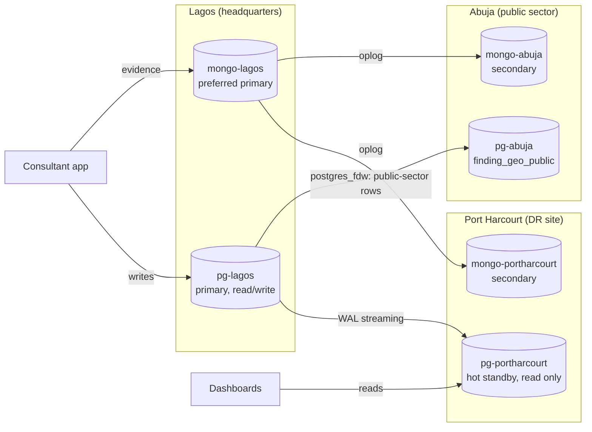

# Portfolio 5: Distributed and Cloud Database Exercise

**Case study:** TerraCyber Consulting EAD, distributed over three Nigerian sites: Lagos, Abuja and Port Harcourt
**Technologies:** PostgreSQL 16 streaming replication and `postgres_fdw`, MongoDB 7 replica set, Docker Compose
**Marks:** 6

## 1. What this portfolio delivers

| Topic named in the brief | What is built and demonstrated | File |
| --- | --- | --- |
| Replication | Lagos primary streams to a hot-standby replica in Port Harcourt; MongoDB replica set with one member per city | `docker-compose.yml`, `config/` |
| Sharding | Public-sector clients' findings stored on the Abuja node; private and NGO findings in Lagos | `sql/geo_sharding.sql`, `sql/abuja_node_init.sql` |
| Availability | Loss of the Lagos site, read-only standby, promotion of Port Harcourt; MongoDB automatic election | `replication_failover_demo.sh`, section 5.4 |
| Consistency | Asynchronous vs synchronous replication; MongoDB write and read concerns | Section 5.5, `mongo/replica-set-demo.js` |
| Deployment | Seven containers from one Compose file; optional managed cloud deployment | Section 7 |

## 2. Why these three sites, and why each has its role

The full analysis, with sources and a weighted scoring of six candidate cities, is in [`../docs/site-selection.md`](../docs/site-selection.md). In short:

| Site | Database role | Why |
| --- | --- | --- |
| **Lagos** | Primary (all writes) | 21 of Nigeria's 28 data centres and most subsea cables; largest client market |
| **Port Harcourt** | Disaster-recovery standby | Only international subsea route that does not pass through Lagos (2Africa via Qua Iboe, Akwa Ibom), 448 km from Lagos. A cut to the Lagos cable cluster, like the March 2024 West African cable outage, does not cut both sites. |
| **Abuja** | Public-sector shard | NITDA's cloud policy emphasises sovereign hosting of government data; the Tier III National Shared Services Centre, federal clients and the regulators (NDPC, NITDA, CBN) are here. Scored highest of the candidate second sites (80/100). |

**Why the shard key is sector, not region.** The Nigeria Data Protection Act 2023 regulates transfers *outside* Nigeria (sections 41 to 43). Since all three nodes are in Nigeria, it does not force a split by region. The rules that do care where data sits are sector rules: government data (NITDA policy) and bank and fintech transaction data (CBN local-hosting requirement from 1 January 2027).

## 3. Architecture



| Container | Site | Role | Host port |
| --- | --- | --- | --- |
| `pg-lagos` | Lagos | Primary; loads the Portfolio 1 schema and seed data | 5432 |
| `pg-portharcourt` | Port Harcourt | Streaming replica cloned with `pg_basebackup` | 5433 |
| `pg-abuja` | Abuja | Stores `finding_geo_public` (public-sector findings) | 5434 |
| `mongo-lagos`, `mongo-portharcourt`, `mongo-abuja` | One per site | MongoDB replica set `rs0` | internal only |
| `mongo-init` | | One-shot container that initiates `rs0` | |

On a laptop all containers share one machine, so network latency between "sites" is near zero. In production each site would be a separate data centre, and the 448 to 526 km between them would add a few milliseconds per round trip. This matters for synchronous replication (section 5.5).

## 4. How to run

```bash
docker compose up -d
docker compose ps                     # wait until the pg containers show "healthy"

# Partitioning: public-sector findings to Abuja (run on the Lagos primary)
docker exec -i pg-lagos psql -U postgres -d ead -f /sql/geo_sharding.sql 2>&1 | tee output/geo_sharding.log

# Replication and failover: Lagos -> Port Harcourt
./replication_failover_demo.sh 2>&1 | tee output/replication_failover.log

# MongoDB replica set
docker exec -i mongo-portharcourt mongosh \
    "mongodb://mongo-lagos,mongo-portharcourt,mongo-abuja/terracyber?replicaSet=rs0" \
    /scripts/replica-set-demo.js 2>&1 | tee output/mongo_rs_before_failure.log
```

Run `geo_sharding.sql` **before** the failover demo, because it needs a writable Lagos primary. The failover demo stops `pg-lagos`. To return to the original layout:

```bash
docker compose down -v && docker compose up -d
```

## 5. Concepts demonstrated

### 5.1 Replication: Lagos to Port Harcourt

`pg-portharcourt` starts with `pg_basebackup -R -S replica1`. It copies the Lagos primary, writes `standby.signal`, then streams WAL records continuously through replication slot `replica1`.

Evidence in the log:

- `pg_stat_replication` on Lagos shows `state = streaming` and the lag columns.
- A client registered in Lagos appears in Port Harcourt about one second later.
- An `INSERT` in Port Harcourt fails with `cannot execute INSERT in a read-only transaction`.

### 5.2 Sharding: public-sector data in Abuja

`finding_geo` is one logical table with three partitions:

| Partition | Rows (seed data) | Physically stored on |
| --- | ---: | --- |
| `finding_geo_private` | 31,870 | pg-lagos |
| `finding_geo_ngo` | 16,810 | pg-lagos |
| `finding_geo_public` | 17,560 | **pg-abuja**, as a foreign table |

One `INSERT ... SELECT` loads all 66,240 findings, and PostgreSQL routes each row to its partition or node. `geo_sharding.sql` then shows three plans:

1. `WHERE sector = 'private'`: **partition pruning**; only `finding_geo_private` in Lagos is scanned.
2. `WHERE sector = 'public'`: a `Foreign Scan`, with the `Remote SQL` that runs in Abuja and the filter pushed down to it.
3. No sector filter, grouped by office: an `Append` over every partition, so the query **fans out** to both nodes. That is the cost of sharding when a query ignores the shard key.

**Design note.** `sector` and `office_code` are copied into `finding_geo` from `client` and `state`. That is a deliberate denormalisation, because a partition key must be a column of the partitioned table.

### 5.3 MongoDB replica set across the three sites

`mongo-init` runs `rs.initiate()` with one member per city. `mongo-lagos` has priority 2, so headquarters is the preferred primary. Every write goes to the primary and reaches Port Harcourt and Abuja through the oplog. With three sites, losing any one still leaves a majority (2 of 3), so the set keeps accepting writes.

### 5.4 Availability and failover

| Event | PostgreSQL (this setup) | MongoDB replica set |
| --- | --- | --- |
| Lagos site lost | Port Harcourt keeps serving **reads**; all **writes** fail | Port Harcourt and Abuja **elect a new primary** automatically, usually within about 10 to 12 seconds |
| Recovery | **Manual**: `SELECT pg_promote()` in Port Harcourt (the demo logs how long it took) | Automatic; when Lagos returns it rejoins as a secondary, then takes back the primary role because of its priority |
| Abuja site lost | Public-sector findings unavailable; private and NGO data unaffected | Majority remains (Lagos + Port Harcourt); no interruption |
| Production equivalent | Patroni or a managed service automates detection and promotion | Built in |

MongoDB failover test (losing Lagos):

```bash
docker stop mongo-lagos
sleep 15
docker exec -i mongo-portharcourt mongosh \
    "mongodb://mongo-portharcourt,mongo-abuja/terracyber?replicaSet=rs0" \
    /scripts/replica-set-demo.js 2>&1 | tee output/mongo_rs_after_failure.log
docker start mongo-lagos
```

After the stop, step 1 shows a new primary in Port Harcourt or Abuja. Step 5 (`w: 3`) times out, because only two sites can acknowledge.

**Single point of failure to discuss:** the Abuja shard has no replica of its own in this setup. In production it would get a standby too, for example in Kano, the strongest remaining candidate site with a Tier IV facility (see `docs/site-selection.md`).

### 5.5 Consistency trade-offs and CAP

**Asynchronous vs synchronous replication.** The default is asynchronous: Lagos confirms a commit before Port Harcourt has it. That is fast, but losing Lagos can lose the last few transactions, and replica reads can be slightly stale.

To demonstrate the trade-off, switch to synchronous replication:

```bash
docker exec -i pg-lagos psql -U postgres -c "ALTER SYSTEM SET synchronous_standby_names = '*';" -c "SELECT pg_reload_conf();"
docker exec -i pg-lagos psql -U postgres -d ead -c "SELECT application_name, sync_state FROM pg_stat_replication;"   # now 'sync'
docker stop pg-portharcourt
docker exec -i pg-lagos psql -U postgres -d ead -c "UPDATE ead.office SET office_name = office_name WHERE office_code = 'LOS';"
# The UPDATE hangs: Lagos will not confirm a commit that no standby has received.
# Press Ctrl+C, then restore:
docker start pg-portharcourt
docker exec -i pg-lagos psql -U postgres -c "ALTER SYSTEM RESET synchronous_standby_names;" -c "SELECT pg_reload_conf();"
```

After Ctrl+C, PostgreSQL warns that the transaction was already committed locally but may not have reached the standby. That warning is the guarantee being broken.

**MongoDB write and read concerns** (`replica-set-demo.js`):

| Setting | Guarantee | Cost |
| --- | --- | --- |
| `w: "majority"` | Write survives the loss of any one site | Waits for 2 of 3 sites to acknowledge |
| `w: 3` | All three sites have it | Fails or times out if any site is down |
| `readConcern: "majority"` on the primary | Never returns data that could be rolled back | Slightly older view during failover |
| `readPreference: "secondary"` | Takes load off Lagos | May be stale (eventual consistency) |

**CAP in TerraCyber terms.** If the network between Lagos and the other sites breaks, the system must choose consistency or availability:

| Data | Choice | Reason |
| --- | --- | --- |
| Invoices and payments (naira) | **Consistency** (CP): synchronous replication or a single writer; refuse writes rather than diverge | Money must never double-count |
| Findings and engagements | **Consistent writes in Lagos; stale reads acceptable** in Port Harcourt | A dashboard a few seconds old is fine |
| Public-sector findings in Abuja | **Consistency**: unavailable during a partition rather than copied elsewhere | Keeping government data in its designated hosting site matters more than availability |
| Evidence uploads | **Availability** with `w: "majority"`: keep accepting uploads on the majority side | Losing an upload during fieldwork is worse than a brief delay |

## 6. Evidence checklist

- [ ] `output/geo_sharding.log`
- [ ] `output/replication_failover.log`
- [ ] `output/mongo_rs_before_failure.log` and `output/mongo_rs_after_failure.log`
- [ ] Screenshot of `docker compose ps` with all containers running
- [ ] Screenshot of Port Harcourt's read-only error and of the successful write after promotion
- [ ] Screenshot of the synchronous replication hang (optional, strong evidence for the CAP discussion)

## 7. Optional: managed cloud deployment

The three-site design maps directly onto Nigerian colocation providers: Rack Centre or Equinix LG1 in Lagos, Equinix PR1 in Port Harcourt, and Galaxy Backbone's NSSC in Abuja. These are not free to try. For hands-on cloud evidence on a student budget:

1. Create a small **Azure Database for PostgreSQL, Flexible Server** (Burstable tier). Check the current Azure free account or Azure for Students terms first; they change.
2. Under **Networking**, allow only your own IP address.
3. Load the schema and data: `psql "host=<server>.postgres.database.azure.com user=<admin> dbname=postgres sslmode=require" -f ../portfolio-1-database-design/schema.sql`, then `seed.sql`.
4. Check Microsoft's current list of Azure regions and note in your write-up which region you used. Azure's long-standing African regions are in South Africa. If the region you use is outside Nigeria, hosting there is a cross-border transfer under NDPA sections 41 to 43 and would not meet the CBN requirement for payment data. That is exactly why the design above uses Nigerian data centres.
5. Screenshot the overview page and a query result. Then **stop or delete the server** to avoid charges.
