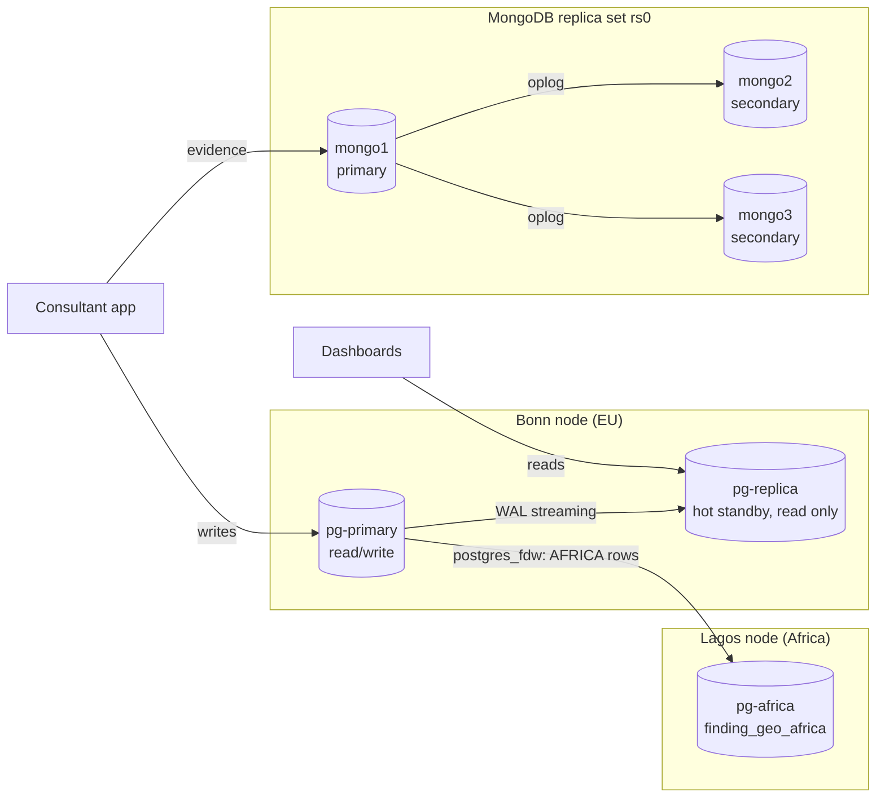

# Portfolio 5: Distributed and Cloud Database Exercise

**Case study:** TerraCyber Consulting EAD
**Technologies:** PostgreSQL 16 streaming replication and `postgres_fdw`, MongoDB 7 replica set, Docker Compose
**Marks:** 6

## 1. What this portfolio delivers

| Topic named in the brief | What is built and demonstrated | File |
| --- | --- | --- |
| Replication | PostgreSQL primary with a streaming hot-standby replica; MongoDB 3-node replica set | `docker-compose.yml`, `config/` |
| Sharding | Findings geo-partitioned by data residency; African clients' rows stored on a separate Lagos node | `sql/geo_sharding.sql` |
| Availability | Primary failure, read-only standby, manual promotion; MongoDB automatic election | `replication_failover_demo.sh`, section 5.4 |
| Consistency | Async vs sync replication; MongoDB write and read concerns | Section 5.5, `mongo/replica-set-demo.js` |
| Deployment | Seven containers from one Compose file; optional managed cloud deployment on Azure | Section 7 |

## 2. Why TerraCyber needs a distributed database

- **Multiple offices.** TerraCyber works from Bonn, Lagos and Nairobi. A single server is a single point of failure for all three.
- **Data residency.** EU clients' data falls under GDPR. African clients increasingly expect their data to stay in-region (for example under Nigeria's NDPA and Kenya's Data Protection Act). Findings should physically live where the client's rules require.
- **Read-heavy reporting.** Compliance dashboards read far more than consultants write. Replicas can take that load off the primary.

## 3. Architecture



| Container | Role | Host port |
| --- | --- | --- |
| `pg-primary` | EU primary; loads the Portfolio 1 schema and seed data | 5432 |
| `pg-replica` | Streaming replica cloned with `pg_basebackup` | 5433 |
| `pg-africa` | Lagos node holding African clients' findings | 5434 |
| `mongo1`, `mongo2`, `mongo3` | MongoDB replica set `rs0` | internal only |
| `mongo-init` | One-shot container that initiates `rs0` | |

## 4. How to run

```bash
docker compose up -d
docker compose ps                     # wait until the pg containers show "healthy"

# Replication and failover (PostgreSQL)
./replication_failover_demo.sh 2>&1 | tee output/replication_failover.log

# Geo-sharding (run on the primary)
docker exec -i pg-primary psql -U postgres -d ead -f /sql/geo_sharding.sql 2>&1 | tee output/geo_sharding.log

# MongoDB replica set
docker exec -i mongo2 mongosh "mongodb://mongo1,mongo2,mongo3/terracyber?replicaSet=rs0" \
    /scripts/replica-set-demo.js 2>&1 | tee output/mongo_rs_before_failure.log
```

The failover demo stops and promotes containers. To get back to the original layout:

```bash
docker compose down -v && docker compose up -d
```

Run `geo_sharding.sql` before the failover demo, or rebuild first, because it needs a writable primary.

## 5. Concepts demonstrated

### 5.1 Replication (PostgreSQL)

`pg-replica` starts with `pg_basebackup -R -S replica1`. It copies the primary, writes `standby.signal`, and then streams WAL records continuously through replication slot `replica1`.

Evidence in the log:

- `pg_stat_replication` on the primary shows `state = streaming` and the lag columns.
- A row inserted on the primary appears on the replica about one second later.
- An `INSERT` on the replica fails with `cannot execute INSERT in a read-only transaction`.

### 5.2 Sharding by data residency

`finding_geo` is one logical table with three partitions:

| Partition | Values | Physically stored on |
| --- | --- | --- |
| `finding_geo_eu` | residency = 'EU' | pg-primary (Bonn) |
| `finding_geo_other` | residency = 'OTHER' | pg-primary (Bonn) |
| `finding_geo_africa` | residency = 'AFRICA' | **pg-africa (Lagos)**, as a foreign table |

One `INSERT ... SELECT` loads all 66,240 findings, and PostgreSQL routes each row to its partition or node. `geo_sharding.sql` then shows three plans:

1. `WHERE residency = 'EU'`: **partition pruning**; only `finding_geo_eu` is scanned.
2. `WHERE residency = 'AFRICA'`: a `Foreign Scan` with the `Remote SQL` that runs on the Lagos node, filter pushed down.
3. No residency filter: an `Append` over all partitions, so the query **fans out** to every node. That is the cost of sharding when queries ignore the shard key.

**Design note.** `residency` is copied from `client.data_residency`, a deliberate denormalisation, because a partition key must be a column of the table. This is the same pattern that sharding products such as Citus use with a distribution column.

### 5.3 MongoDB replica set

`mongo-init` runs `rs.initiate()` with three members. `mongo1` has priority 2, so it is the preferred primary. Every write goes to the primary and reaches the secondaries through the oplog.

### 5.4 Availability and failover

| Event | PostgreSQL (this setup) | MongoDB replica set |
| --- | --- | --- |
| Primary stops | Replica keeps serving **reads**; all **writes** fail | Remaining two nodes **elect a new primary** automatically, usually within about 10 to 12 seconds |
| Recovery | **Manual**: `SELECT pg_promote()` on the replica (the demo logs how long it took) | Automatic; the old primary rejoins as a secondary, then takes back the primary role because of its priority |
| Production equivalent | Patroni or a managed service automates detection and promotion | Built in |

MongoDB failover test:

```bash
docker stop mongo1
sleep 15
docker exec -i mongo2 mongosh "mongodb://mongo2,mongo3/terracyber?replicaSet=rs0" \
    /scripts/replica-set-demo.js 2>&1 | tee output/mongo_rs_after_failure.log
docker start mongo1
```

After the stop, step 1 shows a new primary. Step 5 (`w: 3`) times out because only two nodes can acknowledge.

### 5.5 Consistency trade-offs and CAP

**PostgreSQL asynchronous vs synchronous replication.** The default is asynchronous. The primary confirms a commit before the replica has it. That is fast, but a crash can lose the last few transactions, and replica reads can be slightly stale.

To demonstrate the trade-off, switch to synchronous replication:

```bash
docker exec -i pg-primary psql -U postgres -c "ALTER SYSTEM SET synchronous_standby_names = '*';" -c "SELECT pg_reload_conf();"
docker exec -i pg-primary psql -U postgres -d ead -c "SELECT application_name, sync_state FROM pg_stat_replication;"   # now 'sync'
docker stop pg-replica
docker exec -i pg-primary psql -U postgres -d ead -c "UPDATE ead.office SET office_name = office_name WHERE office_id = 1;"
# The UPDATE hangs: the primary will not confirm a commit no standby has received.
# Press Ctrl+C, then restore:
docker start pg-replica
docker exec -i pg-primary psql -U postgres -c "ALTER SYSTEM RESET synchronous_standby_names;" -c "SELECT pg_reload_conf();"
```

Note that after Ctrl+C, PostgreSQL warns that the transaction was already committed locally but may not have reached the standby. That warning is the guarantee being broken.

**MongoDB write and read concerns** (`replica-set-demo.js`):

| Setting | Guarantee | Cost |
| --- | --- | --- |
| `w: "majority"` | Write survives the loss of any one node | Waits for 2 of 3 acknowledgements |
| `w: 3` | Every node has it | Fails or times out if any node is down |
| `readConcern: "majority"` on the primary | Never returns data that could be rolled back | Slightly older view during failover |
| `readPreference: "secondary"` | Takes load off the primary | May be stale (eventual consistency) |

**CAP in TerraCyber terms.** During a network partition between offices, a system must choose consistency or availability:

| Data | Choice | Reason |
| --- | --- | --- |
| Invoices and payments | **Consistency** (CP): synchronous replication or a single writer; refuse writes rather than diverge | Money must never double-count |
| Findings and engagements | **Consistency on write, stale reads acceptable**: async replica for dashboards | A dashboard a few seconds old is fine |
| Evidence uploads | **Availability** with `w: "majority"`: keep accepting uploads on the majority side | Losing an upload during fieldwork is worse than a brief delay |

## 6. Evidence checklist

- [ ] `output/replication_failover.log`
- [ ] `output/geo_sharding.log`
- [ ] `output/mongo_rs_before_failure.log` and `output/mongo_rs_after_failure.log`
- [ ] Screenshot of `docker compose ps` with all containers running
- [ ] Screenshot of the replica's read-only error and of the successful write after promotion
- [ ] Screenshot of the synchronous replication hang (optional, strong evidence for the CAP discussion)

## 7. Optional: managed cloud deployment

To add real cloud evidence, deploy the primary database to **Azure Database for PostgreSQL, Flexible Server**. The smallest Burstable tier is enough. Check the current Azure free account or Azure for Students terms first; they change.

1. Create the server in a region near the client, for example Germany West Central for EU data.
2. Under **Networking**, allow only your own IP address.
3. Load the schema and data: `psql "host=<server>.postgres.database.azure.com user=<admin> dbname=postgres sslmode=require" -f ../portfolio-1-database-design/schema.sql`, then `seed.sql`.
4. Under **High availability**, read about zone-redundant HA, and under **Replication**, read about read replicas. Compare them with what you built by hand in sections 5.1 and 5.4.
5. Screenshot the overview page and a query result. Then **stop or delete the server** to avoid charges.
